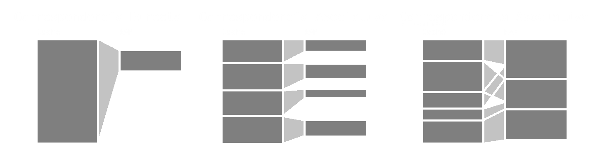
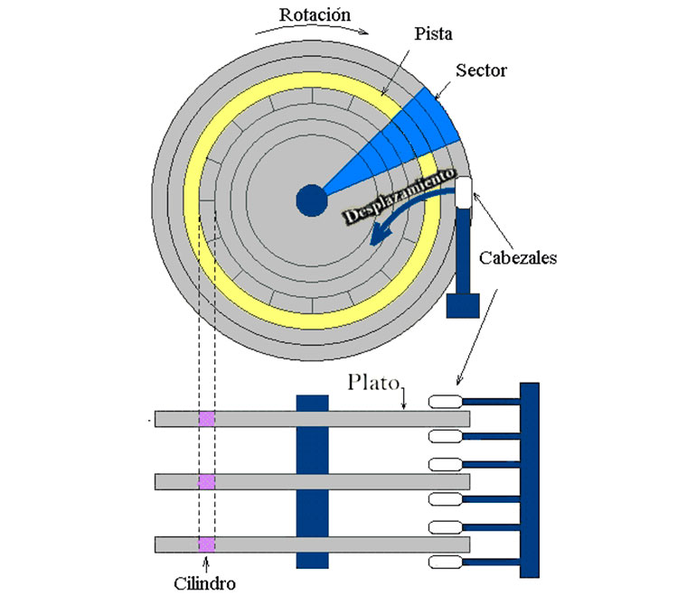
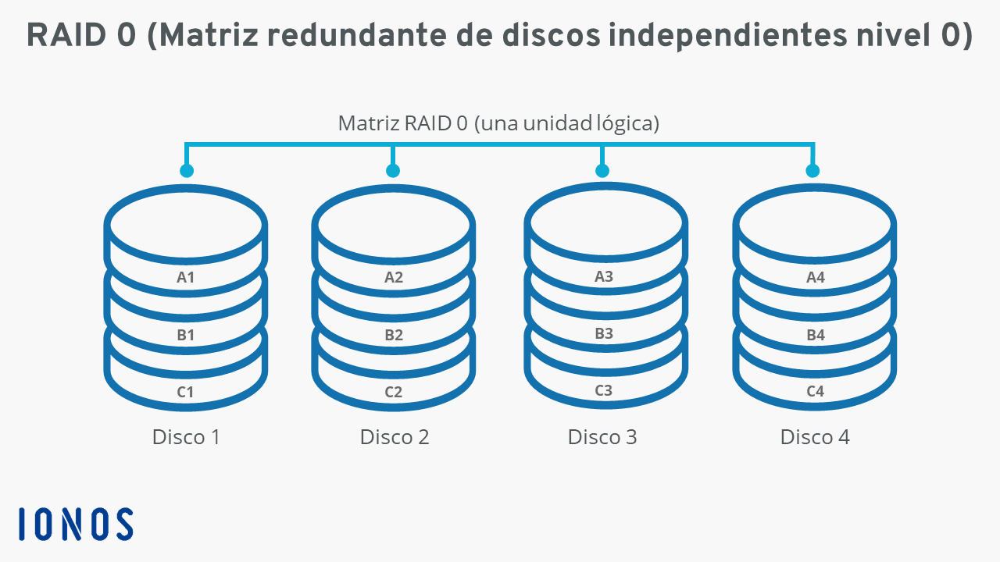
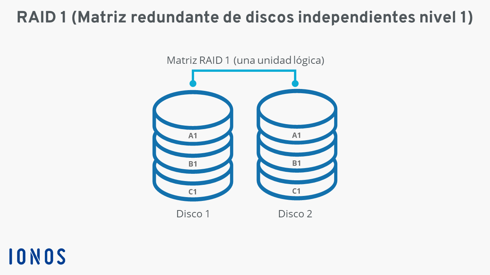
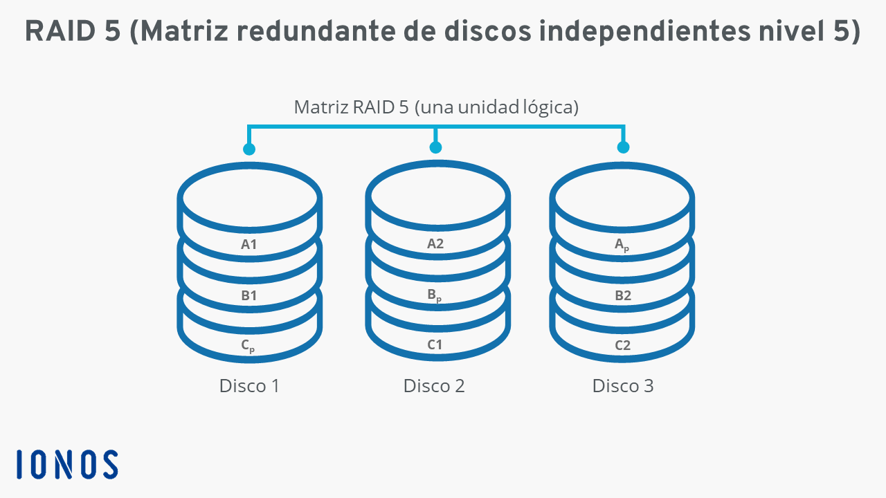
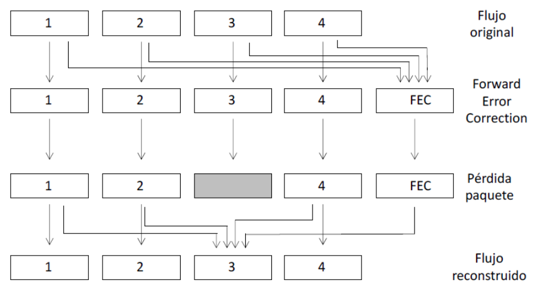

# **Administración de Redes y Servidores**
*Autor:* Christian Velasco Pérez 
\
El siguiente contenido corresponde a un **apoyo** educativo para cualquier interesado y por eso puede contener fallos. El documento está orientado al curso de *Administración de Redes y Servidores* del Grado en Ingeniería Informática de la Universidad de La Rioja y se considera completa responsabilidad del lector lo que haga con la información de este documento.
\
La distribución del documento queda reservada al permiso explícito de su autor. Si necesitase información de contacto puede [enviar un correo](mailto:velskopezz@gmail.com).

## Sobre la Administración de Redes y Servidores

Un **servidor** es una computadora que **provee de servicios a clientes**. También es el *software* que utilizan los servidores.
\
El *hardware* de un servidor es distinto y fundamentalmente **costoso** y necesitado de **mantenimiento**.

# TEMA 1: Introducción

Es imporante detectar que el *hardware* de servidor es para servidores por lo que no ofrecen las necesidades requeridas por los ordenadores de sobremesa. Los sistemas de servidores están hechos para **resistir fallos** mediante redundancias. Es lo que se llama **máquina Tolerante a Fallos**. Se aprecia **fidelidad**.

## Microprocesador

Constituye la **unidad central de procesamiento** (CPU). Se dedica a **materializad instrucciones** necesariamente escritas a **bajo nivel**.

Los microrocesadores de servidor **priorizan las tareas únicas** que se deben ejecutar con una temporalidad indefinida sobre la **apertura de flujos y procesos**.

> También existen los **servidores de apliación**, un punto intermedio entre computadores personales y servidores.

La diferencia radica en la **cantidad de memoria caché** que proporciona dificultades en **direccionamiento** de la inromación, lo que facilita la lectura pero dificulta la escritura.

Se distinguen categorías de microprocesadores de acuerdo con sus características:

- Microprocesadores **RISC** (Reduced Instruction Set Computer)
- Microprocesadores **CISC** (Complex Instruction Set Computer)
- Microprocesadores **EPIC** (Explicity Parallel Instruction Computer)

### Características evolutivas

> Alguna de la siguiente información no es totalmente fiel al documento. Se ha utilizado información actualizada.

#### Ejecución superescalar

Con el objetivo de aumentar la optimización se añadieron **tubos entrenúcleo**. Esto fue porque se notó que los distintos núcleos perdían tiempo esperando a la información.

#### Planificación dinámica

Funciona de tal forma que el núcleo planea la ida y llegada de información para paralelizarlo.

#### Arquitectura de doble bus independiente (DIB)

Proporciona dos buses para el acceso paralelo.

#### *Hyper-Threading Technology* (HT)

Utiliza **núcleos virtuales** para simultanear hilos entre secciones en tiempo compatibles. Aunque el núcleo físico adicional es mejor, el nivel virtual es casi como tener un núcleo más.

#### *Multi-core*

Proporciona múltiples **pares de núcleos** para que se dividan los ***threads*** de tal forma que se duplica la capacidad. Tiene un coste económico inferior que una CPU adicional.

#### Reducción de las tensiones

De forma gradual se logró pasar de **5V** a 3.3V y 1.8V hasta hoy con entre 0.7V y 1.2V. No obstante, llega un punto en el que el **ruido eléctrico** hace imposibilita la tarea de conversión de la señal eléctrica a digital.

### Disposición

Se proporciona una de las formas de calcular la resistencia total de un conjunto:

$$R_{\text{total}} = (T_{\text{case}} - T_{\text{inlet}})/P_{\text{max}} - R_{\text{junction}}$$

> $R_{\text{total}} \equiv \text{``Resistencia total"}$
> \
> $T_{\text{case}} \equiv \text{``Temperatura máxima óptima del CPU"}$
> \
> $T_{\text{inlet}} \equiv \text{``Temperatura ambiente"}$
> \
> $P_{\text{max}} \equiv \text{``Potencia máxima del CPU"}$
> \
> $R_{\text{junction}} \equiv \text{``Resistencia de la pasta térmica"}$

#### Ejemplos

1. **Disponemos de un microprocesador con un bus de direcciones de 32 bits y una memoria con longitud de palabra 8 bits.**
    
    1. **Calcular el tamaño del bloque máximo de memoria direccionable.**

        Se pueden direccionar un total de $2^{32} \cdot 8\text{b} \cdot \frac{1\text{B}}{8\text{b}} = 2^{32}\text{B}$.

    2. **Compararlo porcentualmente con el tamaño del bloque máximo de memoria direccionable en un procesador con bus de direcciones de 64 bits.**

        Con un bus de 64 bits habría $2^{64} \cdot 1\text{B} = 2^{64}\text{B}$ direccionables.

        Dicho de otro modo, sería $\frac{2^{64}\text{B}}{2^{32}\text{B}} = 2^{32}$ veces mayor con un bus de 64 bits.

2. **Disponemos de un procesador que necesita 26 ciclos de reloj para realizar una operación de movimiento de un dato entre memorias. Su frecuencia de trabajo es 20MHz.**
    
    1. **Calcular el tiempo que tarda en mover 1 dato.**

        Efectuamos un factor de conversión.

        $$1 \ \text{dato} \cdot 26 \ \frac{\text{ciclo}}{\text{dato}} \cdot \frac{1\text{s}}{20 \cdot 10^{6} \ \text{ciclo}} = 1.3 \cdot 10^{-6} \text{s} = 4.3 \mu\text{s}$$

    2. **Compararlo porcentualmente con el tiempo que tardaría en mover el dato si el procesador funcionara a 1GHz.**

        Con 1GHz tardaría 

        $$1 \ \text{dato} \cdot 26 \ \frac{\text{ciclo}}{\text{dato}} \cdot \frac{1\text{s}}{10^{9} \ \text{ciclo}} = 26 \cdot 10^{-9} \text{s} = 26 n\text{s}$$

        O, lo que es lo mismo, alrededor de $\frac{26n\text{s}^{-1}}{1.3\mu\text{s}^{-1}} = 50 = 5000\%$ más rápido.

3. **Calcular la resistencia térmica del conjunto del radiador a diseñar para permitir el funcionamiento correcto de un procesador en las siguientes condiciones:**

    > $$R_{\text{total}} = (T_{\text{case}} - T_{\text{inlet}})/P_{\text{max}} - R_{\text{junction}}$$

    - **Microprocesador con las siguientes características:**
        - $T_{\text{case}} = 73º\text{C}$
        - $T_{\text{inlet}} = 38º\text{C}$
        - $P_{\text{max}} = 103\text{W}$
        - Pasta térmica de silicona $0.01º\text{C}/\text{W}$

    $$R_{\text{total}} = (73º\text{C} - 38º\text{C})/103\text{W} - 0.01º\text{C}/\text{W} = 0.33º\text{C}/\text{W}$$

## Chipset

También visto como **socket**, es el componente **estandarizado** que **dictamina el soporte de ciertos tipos de procesadores**.

En servidores es comúm que haya **múltiples chipsets** en la placa madre. El múltiple procesador implica **cargas adicionales en control** por lo que no se suelen proporcionar para uso personal.

## Sistemas de memoria

Comúnmente llamada RAM por la tecnología que la implementa, se identifican dos tipos:
- **DRAM**: lenta
- **SRAM**: costosa

También se puede identificar la **memoria caché** y la **memoria virtual**.

La memoria **caché** es de tipo **SRAM** (extremadamente rápida por ello) dividida en entre **3** y 4 niveles.

### Memoria caché

Los datos se alojan en los distintos **niveles** de acuerdo con la **freuencia de uso**.

- **Caché inclusivo**: los datos se mantienen en su nivel de procedencia tras ser transferidos

- **Caché exclusivo**: los datos se extraen y eliminan de su nivel de procedencia tras ser transferidos

La ubicación de su memoria depende de su nivel:

- **L1**: Se encuentra **cercana al núcleo**. Su tamaño es **pequeño** para mover la totalida de información a golpe de clock.

- **L2**: Se encuentra más lejana al núcleo que el L1. Está planteada para funcionar de acuerdo con el reloj de la RAM.

- **L3**: Es más lenta que L2.

> Se trata de la tendencia generalizada. Los fabricantes son libres de alterar esto a su criterio.

#### Políticas de ubicación

Deciden dónde debe colocarse un bloque de memoria principal que ingresa a la caché:



#### Políticas de extracción

Deciden cuándo debe sacarse un bloque de la caché al procesador.

- por **demanda**: se ìde el bloque `n` y se lleva el bloque `n`
- por **prebúsqueda**: se pide el bloque `n` y se lleva dede el `n` hasta el `n + i`

#### Políticas de reemplazo

Deciden cuando un bloque debe abandonar la caché.

- aleatorio
- FIFO
- LRU (usado menos reciente)
- LFU (usado con menor frecuencia)

> Para más información sobre estos algoritmos véase el temario de Sistemas Operativos.

#### Políticas de actualización o escritura

Determinan el instante en el que se actualiza la informacion en memoria cuando se escribe en otra.

- En memoria principal

    - Escritura inmediata
        \
        Se escribe a la vez en memoria principal y caché manteniendo la coherencia.
    - Postescritura
        \
        El bloque donde se escribió queda marcado con un bit de basura a la espera de ser reescrito. Al reemplazo, se escribe la información en la memoria principal.

- Sobre la memoria caché

    - Asignación en escritura
        \
        El bloque referenciado se copia en la caché y, *después*, de la caché a la CPU.
    - No asignación en escritura
        \
        El bloque se envía y carga a la vez en la CPU y caché respectivamente.

### Disco duro magnético

Es una estrictura de varios platos, comúnmente de 6 a 8 a fecha de 2026. Estos giran a **7200rpm** y su dato es cambiado por un **cabezal magnético** por acción magnética; sin tocar el plato. Su tamaño depende de su factor de forma.

Son de aluminio ligero, salvo por la punta magnética, que debe de estar hecha de un material magnético como óxidos de hierro o cobalto.



La desventaja de los discos magnéticos es su **lentitud** debido a su naturaleza mecánica que requiere el movimiento del plato, al contrario que los discos sólidos (SSD).

> Con el fin de aumentar la velocidad de lectura en servidores se aumentaron las revoluciones a hasta 11000rpm.

$$TA = t_{\text{búsqueda}} + t\text{lectura/escritura} + \text{``Latencia"}$$

> $TA \equiv \text{``tiempo medio en obtener la información"}$
> \
> $t_{\text{búsqueda}} \equiv \text{``tiempo medio en leer el disco"}$
> \
> $t_{\text{lectura/escritura}} \equiv \text{``tiempo medio de leer y escribir"}$
> \
> $\text{``Latencia"} \equiv \text{``tiempo de la aguja en situarse en el lugar adecuado"}$

- **Tasa de transferencia**: incluye la velocidad para transferir la información

- **Caché de disco**: permite la lectura de datos antes de que los pida el procesador tras almacenarlo en una pequeña caché

- **Interfaz**: se incluye IDE/ATA, SATA, SCSI, USB...

En busca de velocidad se crearon los discos **SAS**, variantes de SATA con mayor velocidad y fiabilidad pero de menor capacidad así como se crearon discos **SSD**, sin componentes mecánicos al usar memorias *flash*.

#### Tolerancia a fallos: Configuraciones RAID

Hay múltiples configuraciones RAID. Se mostrarán los RAID 0, 1 y 5 puesto que los RAID 2, 3, 4, 6 y 1+0 o 10 son o bien combinaciones de esos tres o bien RAID 5 con volúmenes u otras unidades de niveles de almacenamiento.

- **RAID 0**

    Consiste en hacer ***stripping***: en cada disco se guarda un bloque con la información.
    
    Es una alternativa rápida puesto que se multiplica la velocidad de lectura y escritura, pero es insegura puesto que depende de todos los discos.

    

- **RAID 1**

    Consiste en hacer ***mirrowing***.

    Favorece la seguridad al copiar la informacion, pero aumenta la carga de trabajo.

    

- **RAID 5**

    Distribuye información de **paridad** que permite la reconstrucción de la información. Requiere, al menos, **tres discos**.

    

#### JBOD

De ***Just a Bunch Of Drives***, es equivalente a RAID 0 con **aleatoriedad en las unidades**. Permiten unidades de distinto tamaño sin desperdiciar espacio disponible por ello.

## Sistemas de vídeo

Son poco útiles y generan **poca carga y calor**.

## Adaptadores de red

Es un recurso importante puesto que de esto depende la comunicación del servidor.

### Tarjetas de red

Las **NIC** de servidores tienen 2 adaptadores para, lejos de duplicar el ancho de banda, la **tolerancia a fallos**.

> El ancho de banda no suele ser limitante desde el lado del computador sino desde la contratación.

Cada adaptador de red viene con su dirección MAC única en una memoria ROM y cuyo valor viene fijado por el IEEE.

Para la transmisión de información se usan **NRZ**, **NRZ-I**, **Manchester** y **Manchester diferencial**.

> Para más información, véase la información en [Redes de Computadores](../2º/Redes_de_Computadores.md).

### Técnicas contra fallos

- Redundancia
- Replicación
- Distribución
- Autocorreción
- ...

### Infraestructura

En PYMEs suele ser más holgado, aunque en **centros de datos** se tiene en cuenta:

- ubicación segura
- acceso fácil
- instalación eléctrica y de telecomunicaciones
- capacidad de evacuación del calor
- estructura resistente al peso
- protección contra desastres

Estas dificultades llevan a muchos a elegir **alternativas Cloud**.

# TEMA 2: Introducción a la estructura cliente-servidor

Funciona de forma que un dispositivo servidor proporciona servicios a múltiples clientes. Para enviar información por la red se usan sistemas y tecnologías como las capas de Internet, Ethernet, segmentación, multiplexación...

> Buena parte de la información de este tema consiste en un resumen de lo visto en [Redes de Computadores](../2º/Redes_de_Computadores.md). Toda esa información queda omitida en este documento.

## Protocolo RIP

Utiliza el **conteo de saltos** como **métrica**, que debe ser **inderior a 16**. Consiste en enviar un ***broadcast*** cada 30 segundos de la actualización de la topología. Además, hay 3 temporizadores adicionales al **temporizador de actualización**.
- temporizador de **invalidez**: cuando un nodo no envía su actualización por 180 segundos
- temporizador de **purga**: tras 240 segundos, elimina el nodo de la tabla de enrutamiento
- temporizador de **espera

### *Updates* disparados

Pretenden acelerar la convergencia. Se utilizan *updates* disparados para **evitar la espera de temporizadores**.

> Se suele utilizar ante alteraciones manuales de la topología.

Los problemas de los *updates* disparados suelen ser de concurrencia.

### RIPv2

Es una mejora respecto a RIPv1, permite utilizar **máscaras de red**, ***multicast*** y **autenticación**.

## Protocolo IGRP

El *Interior Gateway Routing Protocol* es un protocolo desarrollado por Cisco que considera el **ancho de banda**, **retardo**, **carga** y **confiabilidad**. Por defecto, se envía un *broadcast* de las actualizaciones cada 90 segundos. Está obsoleto y es predecesor de EIGRP.

## Protocolo EIGRP

> Este no está del todo obsoleto.

Es un protocolo de enrutamiento por **vector de distancias** patentado por Cisco.

Utiliza un algoritmo de **actualización por difusión** (DUAL). En este algoritmo no existen actualizaciones periódicas. En su lugar, se envían únicamente tras un **cambio en la topología**.
- actualizaciones **no periódicas**: irregulares
- actualizaciones **parciales**: tras un cambio
- actualizaciones **limitadas**: sólo **actualizan quienes lo necesitan** de forma que **minimiza el ancho de banda**

### Protocolo de saludo

El protocolo EIGRP necesita conocer a sus vecinos. Para **descubrir**, envían a los *routers* adyacentes un **saludo cada 5 segundos**. Esto provoca que, mientras se reciban estos paquetes, las **rutas permanecen viables**.

Antes de declarar un **vecino inalcanzable**, debe pasar un **tiempo de espera**: 3 paquetes de saludo. Tras ello, se **desactiva la ruta** y se **busca una alternativa**.

El algoritmo utilizado es el **algoritmo de actualización por difusión** (DUAL) en lugar de otros algoritmos Bellman-Ford como usa RIP. El objetivo es la **sincronización** y **evitar bucles**.

> DUAL toma más tiempo que Bellman-Ford.

Utiliza una **métrica de enrutamiento compleja** que genera tres tablas:
- vecinos
- topología
- enrutamiento

## Algoritmo de Bellman-Ford

Hace una estimación del coste mínimo:

$$D_{x}(y) = min_y({c({x,v})+d_{v}(y)})$$

> $D_x(y) \equiv \text{''estimación del coste"}$
> \
> $c(x,v) \equiv \text{''coste de x hasta el nodo v"}$
> \
> $d_v(y) \equiv \text{''coste (según v) que le toma llegar al nodo"}$

> Véase el vídeo del proceso en el aula virtual.

Este algoritmo busca una **convergencia** en la que, tras múltiples iteraciones, las tablas de encaminamiento permanecen inalteradas.

## Protocolo OSPF

El *Open Shortest Path First* es posterior y con mejoras respecto a RIP. Entre ellas, permite el **direccionamiento sin clase**. Tiene diferentes tipos de paquetes y utiliza el **ancho de banda** como condicionante de métrica.
- **Saludo**: permite descubrir vecinos
- **DBD**: relacionado con la base de datos de la topología
- **LSR**: pide información respecto al estado de un nodo
- **LSU**: responde a los LSR
- **LSAck**: un mensaje de reconocimiento entre LSRs y LSUs.

### Saludo OSPF

Su función principal es **descubrir vecinos OSPF aunque también se incluyen las **condiciones de la conexión**. En este último, se habla de **direcciones de respaldo** y otra información de conexión.

### Información OSPF

Todo se hace mediante paquetes **LSR** y **LSU**. Este último, viene dividido en 10 tipos.
\
La información de paquetes LSU se almacena en una **base de datos** de topología.

El objetivo es hacer una **reconstrucción previa de la topología** de tal forma que todos los nodos la conozcan y, cumpliéndose las condiciones previas, **cada nodo ejecute el algoritmo de Dijkstra** y obtenga la ruta de menor coste.

> Permite cifrado y autenticación.

### Áreas OSPF

Al disponer la información en OSPF se utilizan **máscaras *wildcard***, es decir, que muestran la última dirección disponible (*broadcast*). El objetivo es reducir el tiempo del *router* al calcular.

> e.g.: En lugar de `255.255.255.0` se utiliza `0.0.0.255`.

También existen **áreas** correctamente identificadas. El identificador del área es un campo necesario y de, estrictamente, **8 caracteres** de tamaño.

### Enrutamiento OSPF

Cada **router tiene una ID**, esta corresponderá con una serie de 4 bytes que pueden confundirse fácilmente con una dirección IP puesto que se visualizan de la misma forma.

Las redes hechas por OSPF proporcionan un ***broadcast* automatizado** (la red más alta) si no se proporciona ninguno de forma manual.

> Se puede utilizar `show ip ospfneighbor` en *routers* para ver información OSPF.

> Un *router* puede **pertenecer a tantas áreas como interfaces tenga**.

### Configuraciones e información

Entre otras, se puede disponer un *delay* para ejecutar Dijkstra ante un cambio en la topología (usado para cambios temporales). Se incuye **configuración específica para una interfaz** de red (adaptador físico).

> También se puede ver la métrica.
> \
> En OSPF la métrica es más pequeña: tiene menor precisión pero se compara mejor.

### Métrica OSPF

Se hace el **inverso del ancho de banda** para obtner una métrica en la que, al igual que en la forma tradicional, una menor métrica sea más eficiente.

La métrica corresponde tal que un $\text{coste} = \frac{\text{referencia}}{\it{bandwith}}$ se asocia con una tabla de **tramos de métrica** para obtener la métrica. No obstante, hoy en día es irrelevante el paso anterior puesto que las velocidades de la actualidad siempre llevan a métrica 1 (la más baja).

> La referencia por defecto es $10^8bps$.

> Se puede configurar el *bandwith* a mano para alterar el valor real y producir el efecto deseado. También se puede usar `ip ospf cost <coste>` para forzar el coste.

## Protocolo STP

El *Spanning Tree Protocol* pretende solucionar el problema de los **bucles en mensajes**.

> e.g.: Dos *switches* están conectados de forma directa.
>
> ```
> S1 --- S2
> ```
>
> Si el primer *switch* (S1) envía un mensaje por *broadcast*, el segundo *switch* (S2) lo recibe. Como el *switch* S2 recibe un mensaje de *broadcast* este lo envía por todas sus interfaces, llevándo el mensaje de *broadcast* a S1. En este momento, se genera un bucle puesto que S1 enviará por todas sus interfaces el mensje de *broadcast*.

> Se considera un **puerto bloqueado** cuando el tráfico de red **no puede ingresar ni salir** del puerto, excluyendo las tramas de unidad de datos de protocolo de puentes (BPDU) que utiliza STP.

STP utiliza el **algoritmo *spanning tree* (STA)** para determinar los **puertos de switch que deben configurarse para el bloqueo**.

Funciona de modo que el STA designa un **único *switch* como puente raíz** que se utiliza como **referencia** para los cálculos.
\
Para determinar el puente raíz se utilizan **tramas BPDU** con las que se determina el *switch* que posea el **menor ID de puente (BID)**. Este *switch* con menor BID será el puente raíz.

> Las tramas BPDU contienen un BID que identifica al *switch* que lo envía.
>
> > Un BID contiene:
> > - Valor de prioridad
> > - Dirección MAC del *switch* emisor
> > - ID del sistema extendido (opcional)

Una vez determinado el puente raíz, el STA calcula la **ruta más corta hacia el puente raíz** de tal forma que **todos los *switches* utilizan el STA para determinar los puertos que deben bloquearse**. También se calculan las mejores rutas.

Al conocer las mejores rutas hacia el puente raíz, incluido el dominio de *broadcast*, se **evita que todo el tráfico sea reenviado por todas las interfaces del *switch***.

- **Puertos raíz**: puertos de *switch* más cercanos al puente raíz.
- **Puertos designados**: puertos que no son raíz pero pueden enviar tráfico a la red.
- **Puertos no designados**: bloqueados.
- **Puertos deshabilitados**: administrativamente desactivados.

## Protocolo ARP

El *Address Resolution Protocol* tiene dos funciones básicas:
- **Resolución de direcciones** IPv4 a MAC.
- Mantenimiento de una **caché de asignaciones**.

Para que un dispositivo a nivel de enlace envíe una trama este requeire revisar la tabla ARP o **caché ARP**.

### Tabla ARP

Cada entrada de ARP tiene un par de valores: una **dirección IP** asociada a una **dirección MAC**. Se trata de un mapeado.

Las entradas dinámicas de ARP tienen una **marca horaria** puesto que **caducan con el tiempo**.

### Solicitud ARP

Para actualizar la información sobre ARP se requiere enviar un *broadcast* de capa 2 a los dispositivos de la LAN *Ethernet* preguntando por una **IP de destino**. El dispositivo a cuya dirección lógica le corresponda debe responder por *unicast* al emisor.

## Protocolo ICMP

El *Internet Control Message Protocol* es un protocolo cuya finalidad es **proporcionar información**, lejos de hacer red segura.

> Los mensajes ICMP son, a menudo, rechazados dentro de una red por motivos de seguridad.

Entre sus mensajes más importantes para tanto IPv4 como IPv6 se incluyen:

- **Confirmación de *host***
- **Destino o servicio inaccesible**
- **Tiempo superado**
- **Redireccionamiento de ruta**

### `Ping`

Es una utilidad de prueba que utiliza **mensajes de solicitud y repuesta de *echo* ICMP** para **comprobar la conectividad**.

### `Traceroute`

Genera una **lista de saltos** que se alcanzaron correctamente a lo largo de la ruta.

## Protocolo NAT

El *Network Address Translation* es un protocolo que pretende **conservar las direcciones IPv4 públicas** de forma que se utilizan redes privadas internamente. Nació como un parche temporal para solucionar el problema de la falta de direcciones.

> Existe un dilema en la informática puesto que NAT proporciona seguridad al cubrir las direcciones privadas pero, al mismo tiempo, proporciona una complejidad que se contrapone a la filosofía original de Internet (*End-to-End*) y es sensible a actualizaciones en la capa de aplicación. Además, recalcular los *checksums* de TCP y UDP requiere tiempo de procesamiento.
>
> En IPv6 se optó por prescindir de NAT.

- **NAT estática**
    \
    Una dirección privada se traduce a una única dirección pública.

- **NAT dinámica**
    \
    Una dirección privada se mapea a una pública basándose aen una tabla de direcciones públicas registradas.
    
    > Normalmente, el *router* NAT eligirá una dirección que no esté siendo utilizada por otra dirección privda con el fin de enmascarar la configuración interna y protegere los dispositivos.

- **Sobrecarga NAT**
    \
    También conocido com PAT (*Port Address Translation*), se utilia para **enmascarar puertos** de tal forma que se permita multiplexar **múltiples solicitudes IP privadas**.

## Aplicaciones multimedia en red

Refiere a cualquier aplicación que emplee **video** o **audio**.

Para poder tratar correctamente con vídeo y audios se debe tener en cuenta ciertos conceptos:

- **retardo** (retardo fijo): es un tipo **fijo** de propagación.
- ***jitter*** (retardo variable): es un retardo de encolamiento que depende de las *queues* por las que pasas el paquete.
- **caudal**

> Cuando una *queue* se completa porque el tráfico supera a la capacidad de red, los paquetes que no se pueden almacenar quedan descartados. Por ello, estas aplicaciones requieren **adaptar la tasa de transmisión** al caudal disponible.

### Flujos de vídeo almacenado

En los vídeos se manejan dos magnitudes:

- **Resolución**: refiere a la calidad de imagen del vídeo.
- **Ratio de *frames***: refiere a la cantidad de imágenes por unidad de tiempo del vídeo.

> Estas magnitudes dan lugar al ***bitrate***.

Los vídeos pregrabados se almacenan en servidores que responden a solicitudes de usuario para ver dichos vídeos.

El objetivo es aprovechar **posibles interrupciones** para cargar el vídeo en el cliente de forma contínuay mitigar, con ello, el *jitter*. Para eso, se requiere de un ***buffer* de aplicación** en el lado del cliente. Estos *buffers* de aplicación almacenan una serie de paquetes cuya reproducción se espera con proximidad.
\
En estos *buffers* de aplicación también existe un **tiempo de *playout***, es decir, el tiempo que se debe esperar, de acuerdo con las **condiciones de la red**, para almacenar en el *buffer* de aplicación suficiente contenido como para que el usuario no perciba interrupciones suponiendo que se mantienen las condiciones en la red. Si bien esto puede sonar poco lógico, se responde al conocer los **mecanismos de congestión TCP** (véase [Redes de Computadores](../2º/Redes_de_Computadores.md)), que generan picos en el uso de la red.

Además, para **distribuir cantidades masivas de datos** a usuarios de todo el mundo, se hace uso de **CDN**s (*Content Distribution Networks*) que **gestionan servidores en múltiples ubicaciones geográficas** con copias del contenido. Estas CDNs interceptan las solicitudes y proporcionan a un servidor de forma arbitraria la responsabilidad de responder la petición de un usuario.

- **CDN privada**: propiedad del proveedor de contenido.
- **CDN comercial**: distriñbuye para múltiples proveedores de contenido.

> *Véase en transparencias ejercicios*.

#### RTSP

El *Real Time Straming Protocol* es un protocolo que proporciona funcionalidad para **controlar la reproducción** de un contenido.

### Voz sobre IP

En los audios se manejan dos magnitudes:

- ***Sampling*** (muestreo): instantes del tiempo discretos a los que se asocia un valor.
- **Cuantización**: valores mínimos y máximos entre los que se puede manejar un valor de muestreo.

Se proporcionan herramientas para combatir las **fluctuaciones**:
- Añadir un **número de secuencia**
- Añadir una **marca de tiempo**
- Añadir un **retardo en la reproducción**
    - retardo **fijo**
    - retardo **adaptativo**: aprovecha silencios
- **Compresión/alargamiento en periodos de silencio**

$$d_i = (1-u) \cdot d_{i-1} + u \cdot (r_i - t_i)$$

> $d_i \equiv \text{''retardo medio"}$
> \
> $u \equiv cte$
> \
> $r_i - t_i \equiv \text{''retardo observado"}$

$$v_i = (1-u) \cdot v_{i-1} + u \cdot |r_i - t_i - d_i|$$

> $v_i = \text{''desviación del retardo respecto a la media"}$

$$q_i = d_i + k \ v_i$$

> $q_i \equiv \it{''talkspurt"} = \text{rafaga de conversación"}$

La pérdida de paquetes se mitiga con **corrección de errores**.

#### FEC

Los algoritmos ***Forward Error Correction*** permiten la reconstrucción al **añadir información redundante**.

Mediante un algoritmo similar a CRC, se crea un paquete FEC por medio de vcarios paquetes que permite, parcialmente, recrear el paquete perdido.

> Similar a RAID 5.

