# **Arquitectura de Computadores**
*Autor:* Christian Velasco Pérez 
\
El siguiente contenido corresponde a un **apoyo** educativo para cualquier interesado y por eso puede contener fallos. El documento está orientado al curso de *Arquitectura de Computadores* del Grado en Ingeniería Informática de la Universidad de La Rioja y se considera completa responsabilidad del lector lo que haga con la información de este documento.
\
La distribución del documento queda reservada al permiso explícito de su autor. Si necesitase información de contacto puede [enviar un correo](mailto:velskopezz@gmail.com).

## Sobre la Arquitectura de Computadores
Se refiere a los **atributos** del computador que resutlan **visibles** para el programador y que debe conocer para programar **cada uno de los computadores** y para **programar a bajo nivel**.

# TEMA 1: Introducción
## Funciones básicas del computador
Se distinguen 4 funciones básicas divididas en componentes:
- **Procesamiento**
- **Almacenamiento** persistente y no persistente
- **Transferencia** de entrada, salida y comunicación
- **Control**

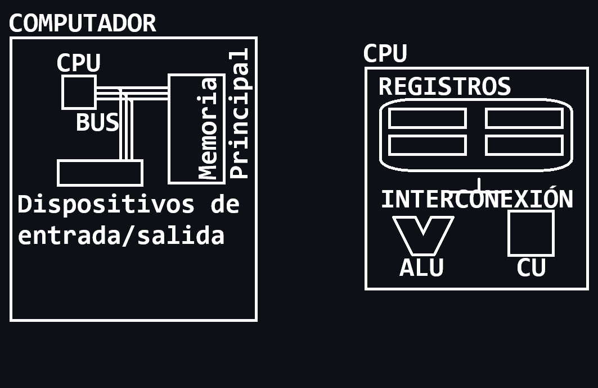

> Se asocia:
> 
> CPU con procesamiento y control.
> \
> Memoria principal con almacenamiento.
> \
> Dispositivos de entrada/salida con transferencia.

Memoria interna | |
--: | :--
Mayor velocidad | Registros de CPU
| | Memoria caché
| | Memoria principal

Memoria externa | |
--: | :--
| | Disco duro
Mayor capadidad/coste | Otros

# TEMA 2: Evolución de los computadores
## Generaciones
Indican la tecnología basada para crear el computador.

Un **elemento de conmutación** es un dispositov en el que se puede controlar la circulación de la **corriente eléctrica** entre dos terminales mediante la aplicación de un nivel de la tensión eléctrica en un **tercer terminal de control**.

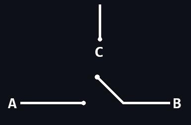

Los elementos de conmutación son los **elementos básicos para contruir las puertas lógicas y biestables** que constituyen los **circuitos digitales**. Las generaciones de computadores vienen dados por la forma de implementarlo:
- **Gen1**: tubos de vacío / válvulas
- **Gen2**: transistores

### Generación 1
Utilizaba válvulas y es la generación de **ENIAC**, el primer computador de **propósito generalizado**, es decir, con fines **reprogramables**. Se trata del **primer computador digital**. Fue producto de la reprogramación de una calculadora de tablas de armas que no llegó a tiempo (1947) para la Segunda Guerra Mundial.
\
Funciona según el paradigma del **programa cableado**. Para cambiar el programa es necesario alterar conexiones y conmutadores, es decir, tocar cableado.

También es la generación del **computador IAS** (*Institute for Advanced Studies*), también llamada "***la máquina de von Neumann***", funcionaba con el paradigma del **programa almacenado**, es decir, almacena representaciones de secuencias de cálculo junto con los datos en la memoria principal.
\
Esta arquitectura se ha mantenido hasta ser hoy en día la más utilizada en la mayoría de computadoras. Funciona de tal manera que en memoria se almacenan **datos** e **intrucciones**.

- **Datos**: significan cosas
- **Instrucciones**: hacen cosas

Existe, además, una alternativa: la **arquitectura Harvard**.

### Generación 2
Existían inconvenientes que creaban la necesidad de un cambio. Los computadores de primera generación eran:

- voluminosos (ENIAC: +2000 válvulas)
- pesados (ENIAC: +30t)
- eléctricamente costoso (ENIAC: bombillas)
- calurosos (ENIAC: ~140kW)
- se pueden fundir

Estos problemas persistieron hasta 1947 con la llegada del **transistor** que lograba las funcionalidades necesarias de ENIAC sin las inconveniencias mencionadas.
\
Se dice que el transistor es un **dispositivo de estado sólido** por su indivisibilidad.

Es la ventaja del transistor la que constituye la segunda generación.

### Generación 3+
El problema de los transistores es que generan **inseguridad** puesto que pueden caerse y necesitar ser **resoldados**. Conforme aumentaba la complejidad de los computadores también lo hacía su cantidad de transistores, aumentando el peligro.

Por contraparte, se decidió **unir múltiples transistores en un único silicio** para constituir piezas diferenciadas. Es decir, deshacerse de **componentes discretos** en forma de transistor para crear un **circuito integrado**.
\
En 1958 nace el primer **circuito integrado** comenzando así la **era de la microelectrónica**.

De acuerdo con la **Ley de Moore**, cada 1.5 años se duplica la cantidad de transistores que se pueden unir a un circuito integrado.
\
Escalas de integración:
- **SSI** (Small Scale of Integration)
- **MSI** (Medium Scale of Integration)
- **LSI** (Large Scale of Integration)
- **VLSI** (Very Large Scale of Integration)
- **ULSI** (Ultra Large Scale of Integration)

Es **consecuencia de la Ley de Moore**:
- **Precios accesibles**
    > Por la capacidad del hardware.
- **Mayor velocidad**
    > Por la proximidad de los transistores.
- **Menor consumo**
    > Por transistor.
- **Menor calentamiento**
    > Por el menor consumo.
- **Mayor versatilidad**
    > Por capacidad de hardware.
- **Mayor conssitencia**

Los avances más interesantes entre estas últimas generaciones fueron la **memoria semiconductora**y el **microprocesador**.

#### Memoria semiconductora

Inicialmente, la memoria se implementaba mediante **núcleos de ferrita**: anillos de material ferromagnético con cables entrelazados que podían ser magnetizados con distinta polaridad según el sentido de la corriente.
\
Estos núcleos son:
- **voluminosos** (2 milímetros para almacenar un bit)
- **costosos**
- con **lectura destructiva**

La memoria semiconductora **sustituyó a los núcleos de ferrita** porque superaba sus inconvenientes y proporcionaba, además, mayor **velocidad**.


> El escudo de los ingenieros queda representado por el núclo de ferrita. El resto de elementos corresponden a simbología de prestigio y la Corona por los orígenes de la ingeniería en España y su afiliación con las autoridades.

#### Microprocesador

Los primeros circuitos necesarios tenían la necesidad de **soldarlos** par crear en conjunto una CPU. Con el aumento de **transistores por circuito** (Ley de Moore) cada vez eran necesarios **menos circuitos integrados**.
\
Finalmente, en 1971 se produce el primer microprocesador: **un procesador contenido en un único circuito integrado**.

> El primer microprocesador era de 4 bits de anchura de datos. Hoy en día se ha incrementado en orden de potencias de 2 hasta los 64 bits.

## Diseño buscando mejores prestaciones

### Equilibro de prestaciones

En el desarrollo de los computadores se hizo fundamental que **todos los componentes vayan oincrementando sus prestaciones de forma equilibrada** con el fin de evitar **cuellos de botella** que degraden el rendimiento general.

El coste más significativo es el **cuello de botella de von Neumann**:
\
El incremento entre la **velocidad del procesador** y la **capacidad de memoria** es muy superior en comparativa con la **velocidad de acceso a memoria**. Esto obliga a buscar **estrategias para compensar** este desequilibrio.

### Procesadores Multicore

Una estrategia habitual cuando un determinado componente alcanza un punto complicado para lograr mejoras en su rendimiento consiste en usar múltiples componentes más simples e intentar un **funcionamiento en paralelo**.

En el caso de los procesadores, es comúnu incorporar en un sólo circuito integrado **múltiples núcleos** (procesadores) funcionando con una **frecuencia de reloj inferior** y **compartiendo una misma memoria caché**.

# TEMA 3: Necesidades de interconexión: buses

## Componentes del computador

De acuerdo con la arquitectura de von Neumann:

1. Se almacenan **datos e instrucciones** en una misma memoria de lectura/escritura.

2. Los contenidos de memoria se direccionan de acuerdo con su **posición en memoria** ignorando su tipo (dato o instrucción).

3. La ejecución del programa se produce siguiendo una **secuencia de instrucciones** salvo que modificaciones por salto.

Además del procesador, un computador va a necesitar **memoria** y **módulos de entrada/salida** para **contener la información** y para **referenciar el exterior** respectivamente.

### Procesador

Está formado por tres componentes principales: ALU, CU y registros.

#### ALU

La unidad aritmético-lógica realiza operaciones aritmético-lógicas.

#### CU

La unidad de control transofrma el lenguaje de bajo nivel a instrucciones para permitir la **programación software**.

#### Registros

Hay registros visibles y de control:

- **visibles**

    > Véase el contenido del grupo reducido 1

- **de control**

    - PC: contador de programa
    - IR: registro de instrucción
    - MAR (Memory Address Register): dirección de memoria a acceder
    - MBR (Memory Buffer Register): dato a escribir en memoria
    - I/O AR: Equivalente a MAR con transferencias entrada/salida en lugar de memoria
    - I/O BR: Equivalente a MBR con transferencias entrada/salida en lugar de memoria

### Funcionalidad de un procesador

Existe un **ciclo de instrucción**: un conjunto de eventos que tienen lugar durante la ejecución de una instrucción. Está compuesto por otros 4 ciclos:
- ciclo de **captación**
- ciclo **indirecto**
    > Véase en el próximo apartado.
- ciclo de **ejecución**
- ciclo de **interrupción**
    > Véase entre los temarios próximos, alrededor del tema 8.

#### Ciclo de captación

Trabaja en **paralelo al ciclo de ejecución** para **evitar el cuello de botella de von Neumann**.

Se dedica a **tomar las intrucciones de la memoria principal** así como de aumentar el **contador de programa** (PC).

#### Ciclo de ejecución

Trabaja en **paralelo al ciclo de captación** con el fin de **decodificar** e interpretar las acciones y operaciones. Seguido, **efectúa las instrucciones** de acuerdo con los siguientes 4 tipos:
- **Transferencia** bilateral de **CPU y memoria principal**
- **Transferencia** bilateral de **CPU y entrada/salida**
- **Procesamiento** de instrucciones
    > e.g.: ADD
- **Control** en instrucciones
    > e.g.: JMP

> e.g.:
>
> 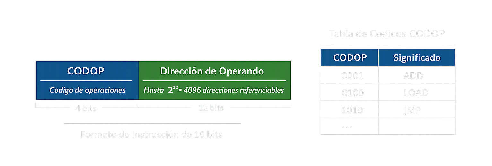

### Interrupciones

Son un mecanismo que permite a otros componentes **interrumpir** el funcionamiento natural del procesador. Supone una **mejora de rendimiento** ay que salva al procesador de comprobar información de forma periódica deteniendo su flujo incluso sin necesidad.

- **Sin interrupciones**
    
    La CPU permanece ociosa mientras espera a la llegada de la información desde los dispositivos de entrada/salida. Como la CPU está gastando ciclos en comprobar si le ha comenzado a llegar la información, no puede continuar el hilo ni ningún otro proceso necesite o no los recursos de los dispositivos de entrada/salida.
    
    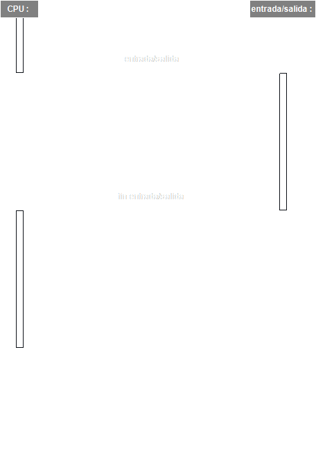

- **Con interrupciones**

    La CPU comunica la necesidad de información y luego continúa con sus tareas hasta ser interrumpida. No pierde el tiempo, se trata de un método más eficiente.

    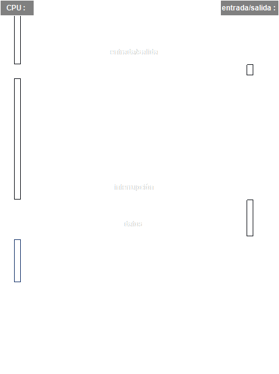

#### Proceso de interrupción

- **Previo** a la atención

    Primero se **termina la ejecución de la instrucción en curso** y, acto seguid, se **transfiere el control a la interrupción**.

    > La instrucción es indivisible, no se puede dejar sin terminar.

- **Posterior** a la atención

    Tras finalizar el gestor de interrupciones hay que ejecutar las **próximas instrucciones del usuario**. Es por ello que se carga el **contexto**: una imagen de, por lo menos, el contrador de programa (PC) y registros de proceso.

    Este contexto se almacena en el **stack** (pila), una estructura LIFO (Last-In First-Out) que permite interrupciones de forma segura.

    > Para información adicional sobre el almacenamiento del contexto y el *swap*, véase los apuntes de Sistemas Operativos.

#### Ciclo de interrupción

Comprende los siguientes pasos:

1. **Guardar el contexto**

    Se incluyeobligatoriamente el **contador de programa** y **registros**. Todo ello almacenado en el **stack**.

2. **Rutina de gestión de la interrupción**

    El **contador de programa** cambia para iniciciar el siguiente ciclo de instrucción de la rutina.
    \
    En los siguientes ciclos se buscara el **origen de la interrupción** y la consiguiente **medida necesaria**.

    Existe lo que se llama **interrupciones múltiples**: un proceso de interrupciones que funciona de forma **recursiva** en tanto que la **prioridad** de la nueva interrupción respecto a la actual lo permita.
    \
    Además de las interrupciones múltiples existe otro tratamiento. Ciertos procesadores antiguos como el 8086 optan por un tratamiento de **interrupción única** en el que existe un **flag de interrupciones** que **inhabilita las interrupciones** mientras se está tratando alguna. Esto implica problemas con interrupciones críticas que requieran una acción urgente.

### Funcionamiento de las entrada/salida

Puesto que era un malgasto de recursos que la CPU fuera intermediaria entre la memoria principal y los dispositivos de entrada y salida, se legó a la conclusión de que se debía conectar todo entre sí a pesar de los ciclos. Esto da lugar al **DMA** (Direct Memory Access)

### Interconexión con buses

Un **bus** es un medio de transmisión compartido. Cualquier dato del bus está disponible para el resto de partes del dispositivo. Es por ello que se requieren **métodos de arbitraje** con el fin de evitar la alteración de los datos

El bus está constituido por **líneas eléctricas**.
- **serie**: por una línea se envía una secuencia de bits
- **paralelo**: se envían bits de forma paralela entre múltiples líneas

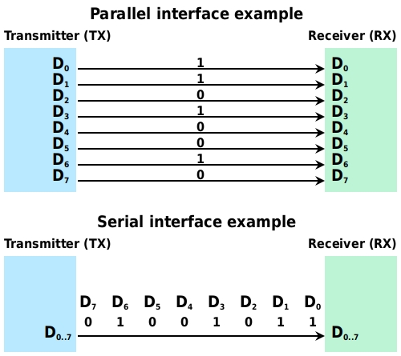

En un computador hay **múltiples buses** siendo el más importante el **bus del sistema**.

#### bus del sistema

El bus del sistema consta de líneas de **datos**, **direcciones**, **control** y, a veces, de **alimentación** (usado, por ejemplo, para USB).

##### Línea de datos

En total constituye lo que se llama **bus de datos**. Se transmiten contenidos en forma de **datos e instrucciones**.

Tiene tantas **líneas como anchura del bus de datos**.

> Representa las **prestaciones** del sistema.

##### Línea de direcciones

Se transmite la **dirección de memoria** o el **número de puerto** de entrada/salida en la que se desea acceder. Conforma el **bus de direcciones**.

> Su **anchura** representa la **capacidad de direccionamiento**.

##### Línea de contol

Sirve para controlar el acceso y uso de las líneas de datos y direcciones. Permite **transmitir** la siguiente información:
- **órdenes**
    > e.g.: `MEMORY READ`, `I/O WRITE`
- **información de temporización**
    \
    Indica la validez de los datos y direcciones-
    > e.g.: `INTERRUPT REQUEST`

#### Jerarquía de buses

Según aumenta el número de dispositivos conectados al bus aumenta el **riesgo de congestión**. Para solventar este problema se utilizan **múltiples buses** organizados de forma **jerárquica**. Por ello, existen múltiples arquitecturas:

1. **bus local**
    \
    Es una conexión **rápida** para el **microprocesador** y la **memoria caché**.

2. **bus del sistema**
    \
    Comunica con la **memoria principal**.

3. **bus de expansión**
    \
    Es más **lento** que los anteriores. Comunica con los **periféricos**.

Esta arquitectura permite liberar a la CPU del uso de intermediario en el traslado de la información por medio de **DMA**s.

##### Arquitectura de altas prestaciones

Existe la llamada **arquitectura de interplaca** que utiliza 4 niveles:

1. **bus local**

2. **bus del sistema**

3. **bus de alta velocidad**
    \
    Para **periféricos veloces**.

4. **bus de expansión**
    \
    Para **periféricos lentos**.

#### Elementos de diseño de un bus

Hablamos de dos **tipos de buses**: **dedicados** y **multiplexados**:

- **Dedicados**

    Las líneas de un bus pueden estar **permanentemente dedicadas** a algo. De ello depende que sean:
    - **Dedicación funcional**: dedicadas a la misma **función**
    - **Dedicación física**: dedicados a un mismo **subconjunto de dispositivos**

    > e.g.: La transmisión de datos y la transmisión de direcciones son dos tipos distintos de funciones, por ello, tener un bus para cada tipo de estas dos transmisiones implica tener buses permanentemente dedicados por dedicación funcional.

- **Multiplexados**

    Existe el uso de **líneas multiplexadas en el tiempo**. Esta opción **reduce costes y tamaño** puesto que hay menos líneas pero proporciona **mayor dificultad de implementación** en un mecanismo complejo que sepa distinguir así como la **lentitud** que conlleva calcular la distinción.

    > e.g.: Permite, por ejemplo, utilizar la misma línea para datos y direcciones.

##### Arbitraje

Implica asegurar que, en cada instante, únicamente un solo dispositivo pueda transmitir al mismo tiempo.

- **Arbitraje centralizado**

    Existe un **árbitro** o **controlador del bus** encargado de asignar los tiempos de uso en el bus. El árbitro puede ser el microprocesador u otro dispositivo.

- **Arbitraje distribuido**

    Todos los **componentes disponene de lógica** para **coodinar** su acceso al bus.

    > Con respecto a la terminología:
    > 
    > - **Master**: dispositivo que va a transmitir
    > - **Slave**: dispositivo al que va dirigida la transmisión
    >
    > Se habla de comunicaciones maestro-esclavo.

##### Temporización síncrona/asínctrona

Depende del uso del reloj.

- **Temporización síncrona**

    Los eventos inician con uin **ciclo** y la mayoría de ellos **duran un ciclo** (`⠸⠉⠧⠤`) Siempre duran una cantidad entera de ciclos.

- **Temporización asíncrona**
    
    Cada evento den el bus es consecuencia de que se haya producido un **evento previo**.

    > e.g.: **MSYN** (*Master Synchronization*), **SSYN** (*Slave Syncrhonization*)

En comparativa, la temporización **síncrona** es de más **fácil implementación** aunqe es limitante en flexibilidad puesto que no permite parovechar las prestaciones de los dispositivos más rápidos. No así como la temporización **asíncrona** en la que cada dispositov puede funcionar a su **máxima frecuencia**.

> e.g.: Un dispositivo RAM de 6400 MHz no puede aprovechar 400 MHz en una placa base con un bus de 6000 MHz. Tendrá que funcionar a velocidad limitada de 6000 MHz. En la realidad el ejemplo queda matizado, el ejemplo pretende ilustrar la realidad lógica de las limitaciones síncronas.

# TEMA 4: Memoria interna

Entre las características de los **sistemas de memoria de computadores** se encuentran las siguientes.

- **Método de acceso**

    - **Secuencial**

        Funciona de fomra que hay un **único mecanismo accesor compartido**. Para acceder al registro deseado hay que pasar secuencialmente por todos los registros intermedios.
        
        Esto implica que no puede dar un tiempo no variable del acceso.

        > e.g.: Unidad de cinta
        >
        > 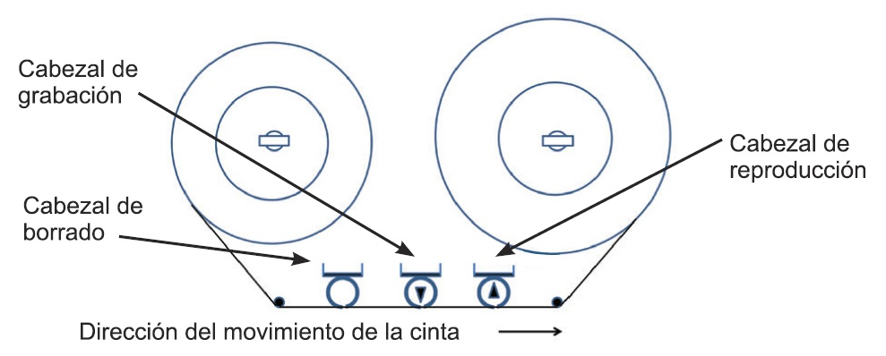

    - **Directo**

        El acceso a la información consta de un movimiento **de la cabeza directo** a la pista a una velocidad sumado a la espera secuencial del sector, es decir, lo que tarda en llegar el cabezal a la pista más lo que tarda en llegar el sector al cabezal.

        Esto hace que el tiempo de acceso sea más variable.

        > e.g.: Disco magnético
        >
        > 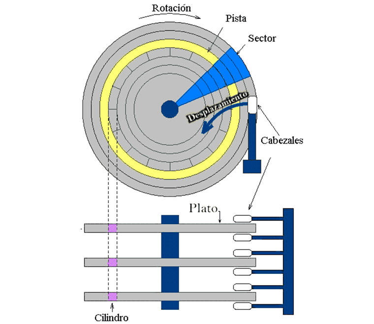
    
    - **Aleatorio**

        Cada posición de memoria tiene su **propio mecanismo accesor** eléctrico y **no compartido**.

        Esto implica que puede elegirse **cualquier posición aleatoria** con un **tiempo de acceso constante**.

        > e.g.: RAM (random access memory)

    - **Asociativo**

        El acceso asociativo **es un acceso aleatorio** en el que la información no se recupera en función de su posición sino en función de una **política respecto a su contenido**.

        Dado que el acceso asociativo es un tipo de acceso aleatorio, este comparte sus características.

        > e.g.: ciertos tipos de memoria caché

> Cita: "Meter una pregunta de esto es probable".

- **Latencia**

    Para memorias de acceso aleatorio es el tiempo que toma llevar a cabo una **operación completa** de lectura o escritura a la información desdde que se **proporcina la dirección hasta que el dato** está disponible o presistido respectivamente.

    Para memorias con acceso secuencial o directo es el tiempo que transcurre hasta que el accesor se posiciona sobre la zona de operación.

- **Soporte físico**
    - **Magnético**
    - **Óptico**
    - **Semiconductor**

- **Cracterísticas físicas**

    - **Volatilidad**
        - Volátil: pierde la persistencia, necesita ser refrescado
        - No volátil: no pierde la persistencia

    - **Borrabilidad**
        - Borrable
        - No borrable

    > Naturalmente, una memoria volátil es obligatoriamente borrable.

## Jerarquía de memoria

Ninguna de las tecnologías es óptima. Es por ello que se utiliza una **combinación jerarquizada** o lo que se llama **jerarquía de sistemas de memoria**. La estrategia es priorizar las siguientes situaciones de acuerdo con las características del dispositivo.

Los dispositivos con **mayor tiempo de acceso** (más lentos) priorizarán:
- **Capacidad**
- **Coste** (€/bit)
- **Menor frecuencia de acceso**
    > Esto se debe al **Principio de la localidad de las referencias**. Para más información sobre Principio de localidad véase en Sistemas Operativos.

> La memoria caché funciona de tal manera que ni el procesador ni el programador deben considerarla.

## Memoria principal semiconductora

Se verán distintas tecnologías de almacenamiento en **circuitos integrados**. Todas utilizarán acceso aleatorio.

- **Memorias de lectura/escritura**
        \
        Ambas operaciones pueden realizarse rápidamente.

    - **RAM** (*random access memory*)
            \
            Destaca porque sus operaciones de **escritura** también son rápidas.
            
        - **DRAM** (*dynamic RAM*)
            \
            Almacena los datos en forma de **carga en condensador**. Con el tiempo se descarga, de ahí el *dynamic*.

            > Se usa en memorias principales por su bajo coste.

        - **SRAM** (*static RAM*)
            \
            Almacena el estado del **biestable**. Son más rápidos que la DRAM porque no invierten tiempo en refrescarse.

            > Se usa en memorias caché.

- **Memorias de sólo escritura**
    
    - **ROM** (*read only memory*)
        \
        Los datos vienen **programados por *hardware*** y, por ello, son costosos y requieren una programación con mínimos errores.

    - **PROM** (*programable ROM*)
        \
        Se fabrica sin programación y el usuario puede **escribir una única vez** con la ayuda de un dispositivo programador. No se puede reprogramar.

- **Memorias de sobre-todo lectura**

    - **EPROM** (*erasable PROM*)
        \
        Antes de alterar el contenido de la memoria se somete a un proceso de **borrado mediante luz ultravioleta**.
        \
        Este proceso borra la totalidad de la programación del chip.

    - **EEPROM** (*electrically EPROM*)
        \
        Utiliza **borrado eléctrico** y **por bytes**, aunque esto las hace **más densas y costosas**.

        > Se diferencia de la RAM en la velocidad de escritura. EEPROM no es volátil pero su velocidad de escritura no es lo suficientemente veloz para la memoria principal.

    - **FLASH**
        \
        Se denomina así por su velocidad para reprogramarse. Sus características son intermedias entre la EPROM y la EEPROM.
        \
        Permite el **borrado eléctrico de bloques** en lugar de bytes. También son, dentro de su categoría, poco densas. De un tamaño similar a la EPROM.

## Corrección de errores

En ciertas ocasiones, los contenidos de la memoria pueden verse innecesariamente alterados. Por ello, existen medios de **deteción** y **corrección** en forma de algoritmos.

### Memorias ECC

Las memorias con *Error Correction Code* utilizan múltiples flujos de datos dedicados a la corrección junto con un **dispositivo corrector**. Para ello, existe otro dispositivo anterior que encuentra el error mediante un **comparador XOR**. Este último puede enviar la **palabra de síndrome** para corregirlo o, si no fuera posible, enviar una **señal de error**.

> El código más famoso es el **código Hamming**.

- **Código Hamming SEC**

    Es un **corrector de grupos simple**, es decir, sólo corrige un bit. A continuación se proporciona un ejemplo con 4 bits de datos y 3 bits de control.

    > E.g.: de forma gráfica para una comprensión más simple
    >
    > 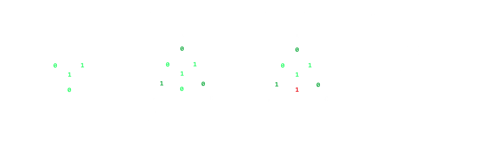
    >
    > > La codificación es binaria por lo que para corregir el error basta con cambiar el bit.
    >
    > A continuación se explica de forma **algebraica** intercambiando $(A, B, C)$ por $(e_1, e_2, e_3)$.

    De acuerdo con el ejemplo anterior, se divide el espacio en corpantimentos.

    $e_1$ | $e_2$ | $e_3$ | compartimento
    --: | --: | --: | :--
    0 | 0 | 0 | Sin error
    0 | 0 | 1 | Comp. 1
    0 | 1 | 0 | Comp. 2
    0 | 1 | 1 | Comp. 3
    1 | 0 | 0 | Comp. 4
    1 | 0 | 1 | Comp. 5
    1 | 1 | 0 | Comp. 6
    1 | 1 | 1 | Comp. 7

    > Nótese como cada compartimento se corresponde a un espacio de intersección entre los *"círculos"*.

    Las próximas operaciones estarán basadas en la paridad de los bytes. Por ello, se utilizará la **operación lógica XOR**. En específico se utilizará como:

    1. **generador de paridad par**
    2. **detector de paridad impar**
    3. **comparador**

    Para usarse en **8 bits de datos** se necesitan **4 bits de comprobación**: un total de **12 bits** cuyos componentes serán $b_{12}$, $b_{11}$, $b_{10}$... hasta $b_1$.

    > No se utilizará $b_0$ puesto que corresponde al compartimento **sin errores**.

    La **palabra de síndrome** está formada por **los 4 bits de comprobación** $(e_1, e_2, e_3, e_4)$. De los 12 bits, desde $b_1$ hasta $b_{12}$, podrá haber **un error en $b_i$**:

    $e_4$ | $e_3$ | $e_2$ | $e_1$ | $b_i$
    --: | --: | --: | --: | :--
    0 | 0 | 0 | 0 | $b_0$
    0 | 0 | 0 | 1 | $b_1$
    0 | 0 | 1 | 0 | $b_2$
    0 | 0 | 1 | 1 | $b_3$
    0 | 1 | 0 | 0 | $b_4$
    0 | 1 | 0 | 1 | $b_5$
    0 | 1 | 1 | 0 | $b_6$
    0 | 1 | 1 | 1 | $b_7$
    1 | 0 | 0 | 0 | $b_8$
    1 | 0 | 0 | 1 | $b_9$
    1 | 0 | 1 | 0 | $b_{10}$
    1 | 0 | 1 | 1 | $b_{11}$
    1 | 1 | 0 | 0 | $b_{12}$
    1 | 1 | 0 | 1 | $b_{13}$
    1 | 1 | 1 | 0 | $b_{14}$
    1 | 1 | 1 | 1 | $b_{15}$

    Vista esta tabla, su correspondencia:

    - $e_4 = b_8 \oplus b_9 \oplus b_{10} \oplus b_{11} \oplus b_{12}$
    - $e_3 = b_4 \oplus b_5 \oplus b_6 \oplus b_7 \oplus b_{12}$
    - $e_2 = b_2 \oplus b_3 \oplus b_6 \oplus b_7 \oplus b_{10} \oplus b_{11}$
    - $e_1 = b_1 \oplus b_3 \oplus b_5 \oplus b_7 \oplus b_9 \oplus b_{11}$

    En cada una de esas situaciones **todos son bits de datos salvo uno**, que es de **comprobación**. El de comprobación es aquel que **no pertenece al resto de componentes de la palabra de síndrome**, es decir, $(b_8, b_4, b_2, b_1)$. Todos potencias de dos.

    > ⚠️ Hasta aquí, corresponde a la comprobación de paridad por XOR.

    A continuación, calculamos los bits $K_i$ tal que $K_i = e_i - b_{2^{i-1}}$:

    - $K_4 = e_4 - b_8$
    - $K_3 = e_3 - b_4$
    - $K_2 = e_2 - b_2$
    - $K_1 = e_1 - b_1$

    > ⚠️ Hasta aquí corresponde a la generación de número impar por XOR.

    Con estos datos obtenemos el **código de Hamming**:

    **$i$** | 12 | 11 | 10 | 9 | 8 | 7 | 6 | 5 | 4 | 3 | 2 | 1 
    :-- | --: | --: | --: | --: | --: | --: | --: | --: | --: | --: | --: | --: 
    **$b_i$** | $m_8$ | $m_7$ | $m_6$ | $m_5$ | $K_4$ | $m_4$ | $m_3$ | $m_2$ | $K_3$ | $m_1$ | $K_2$ | $K_1$

    > Siendo los $m_i$ los bits de datos.

    > ⚠️ Hasta aquí corresponde a la comparación por XOR.

    > E.g.: $M =$ `0b 1101 0010` con código de Hamming `0b 1101 1011 0011`.
    >
    > $K =$ `0b 1011`, obtenido por los bits `8`, `4`, `2` y `1` del código Hamming.
    > \
    > $K' =$ `0b 1101`, obtenido de la suma de los $b_i$ de su compartimento.
    > \
    > $e = K \oplus K' =$ `0b 0110`.
    >
    > Como el valor de $e$ (`0b 0110`) en decimal es `6`, esto indica que el $m_i$ que corresponde al bit 6 del código Hamming tiene un error (`0b 1101 10[1]1 0011`).

    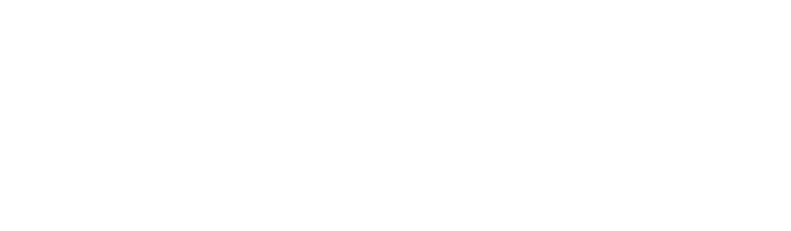

    > Nótese que pasra tratar con $2^nb$ se necesitan, al menos, $n$ bits de comprobación sin contar el **bit de sin error**.
    > \
    > En total, se necesitan $2^K - 1 \ge M + K$.

- **SEC/DED**

    El *Single Error Correction, Double Error Detection* es una **extensión del código Hamming** que permite **corregir 1 error y detectar hasta 2 errores**.
    \
    Para ello, utiliza un **bit de comprobación adicional** sumando un total de $k+1$ bits en total.

    El **bit de comprobación adicional** ($k+1$) se calcula como el `XOR` de todos los bits de la palabra (datos y Hamming anteriores). Esto fuerza que el **total de bits en `1` de toda la palabra sea par**.

    Se realiza una operación **`XOR` de todos los bits, incluido el bit adicional**. Esto genera el **bit de paridad final**
    
    Síndrome Hamming | Bit de paridad final | Tipo de error
    --: | :-- | :--
    $S = 0$ | `0` | Sin error
    $S \ne 0$ | `1` | Error simple (1 error)
    $S \ne 0$ | `0` | Error doble (2 errores)        

## Memoria caché

Pretende transferir ***words*** a la CPU. Estas palabras se obtienen por medio de **bloques** transferidos desde la memoria principal.

> Se basa en el **principio de localidad de las referencias**.

A diferencia de la memoria principal, que tiene $n$ bits para direccionar un rango de $[0,2^{n-1})$ palabras agrupadas en **bloques de $k$ words** ($\therefore |\text{''bloques"}|=\frac{2n}{k}$), la **memoria caché** **almacena líneas**.

> En los procesadores modernos la **relación entre línea y bloque es 1:1**.

Nótese que $C << \frac{2n}{k}$. En memoria caché **no hay espacio** para todos los bloques de la memoria principañ. Cada línea de caché tendrá una **etiqueta que identifica los bloques en la memoria principal**.

### Operaciones de lectura

Hay que distinguir la terminología:
- ***Read Address*** (RA) proporciona la **palabra solicitada por la CPU**.
- **Acierto de caché** cuando el **contenido solicitado se encuentra en la caché**.
- **Fallo de caché** cuando el **contenido no está en la caché**.

En el caso de acierto de caché, la comunicación se hace **completa entre caché y CPU** de forma que los buses de datos y direcciones quedan libres.

### Elementos del diseño de la caché

El tamaño de la caché apenas alcanza unos *megabytes*. Esto se debe al **alto costo** de la SRAM.

> Nótese que una línea mapea múltiples bloques de memoria pero únicamente referencia a uno a la vez.

Se utiliza una **función de corresponencia** que hace **corresponder bloques a líneas** así como **identificar el bloque que ocupa una línea**.

- **Correspondencia directa**

    ```txt
    línea: [ ETIQUETA#(8b) | #INDICE#(14b)# | DW ] (total: 24 bits)
    ```

    Compara la **etiqueta con el índice** de la línea.

    - **Acierto de caché**: Se envía a la CPU el **campo de palabra** asociado.
    - **Fallo de caché**: Se usa la dirección completa para **extraer de la RAM**, se envía y almacena a la caché y, después, se envía a la CPU.

    Entre sus ventajas, esta función de correspondencia requiere una **etiqueta corta** de forma que **requiere menos espacio**. En cambio, es **poco flexible** y susceptible al ***thrashing***, que provoca **contínuos errores de caché que sobrescriben mismas *words***.

    > El *thrashing* (vapuleo) es un suceso en el que dos *words* de distintos bloques que son **mapeados por la misma línea** son referenciados de forma alternativa.

- **Correspondencia asociativa**

    En correspondencia asociativa **no hay líneas preasignadas**.

    ```txt
    línea: [ ####ETIQUETA#(22b)#### | DW ] (total: 24 bits)
    ```
    
    Nuevamente, se comparan las **etiquetas** de todas las líneas de memoria caché con el campo de etiqueta.

    - **Acierto de caché**: Se envía a la CPU el **campo de palabra** asociado.
    - **Fallo de caché**: Se usa la dirección completa para **extraer de la RAM**, se envía y almacena a la caché y, después, se envía a la CPU.

    Esta función de correspondencia es **totalmente flexible** de forma que **evita totalmente el *thrashing***. Sin embargo, requiere **etiquetas muy largas** que aumentan la latencia.

- **Correspondencia asociativa por conjuntos**

    Utiliza **conjuntos de correspondencia directa** entre los que los **datos se distribuyen por medio de correspondencia asociativa** (dentro del conjunto).

    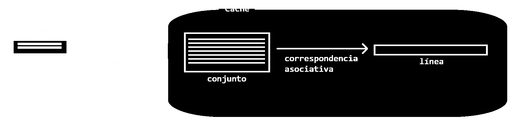

    ```txt
    línea: [ ETIQ#(9b) | CONJUNTO(13b) | DW ] (24 bits)
    ```

    - **Acierto de caché**: Se deben corresponden el **conjunto** y, después, la **etiqueta**. 
    - **Fallo de la caché**: Se pasa el **bloque completo** de memoria principal a la caché y, después, la palabra solicitada de la caché a la CPU.

    Sigue siendo posible el *thrashing* pero se ve minimizado con respecto a la correspondencia directa. En general, son características intermedias.

    > Las otras dos funciones de correspondencia son casos particulares de esta misma.
    >
    > > $n \equiv \text{''número de conjuntos"}$
    > > \
    > > $k \equiv \text{''número de líneas"}$
    > > \
    > > $v \equiv \text{''número de vías"}$
    >
    > - Correspondencia directa: $m=v$; $k=1$
    > - Correspondencia asociativa: $m=k$; $v=1$
    > - Correspondencia asociativa por conjuntos: $k=n$; $v=\frac{m}{n}$
    >   - Con $n=2$ hay una mejora notable
    >   - Con $n=4$ hay una mejora moderada
    >   - Con $n>4$ no hay diferencia perceptible

### Algoritmos de sustitución

Con una función de correspondencia directa no hace falta ningún algoritmo de sustitución especial.

En cambio, con asociatividad, **cada bloque puede ocupar distintas líneas**.

- **LRU** (*Least Recently Used*)
    
    Sustituye por aquel que más tiempo lleva en la memoria **sin ser solicitado**.

    > Se basa en el **principio de localidad de las referencias**.

    En su implementación, **cada línea tiene un bit de uso** inicializado en `1` al leerse y que **cambia a `0` al referenciar otra vía adyacente**. De esta forma, siempre se conoce **cuál bit es el menos referenciado**.

    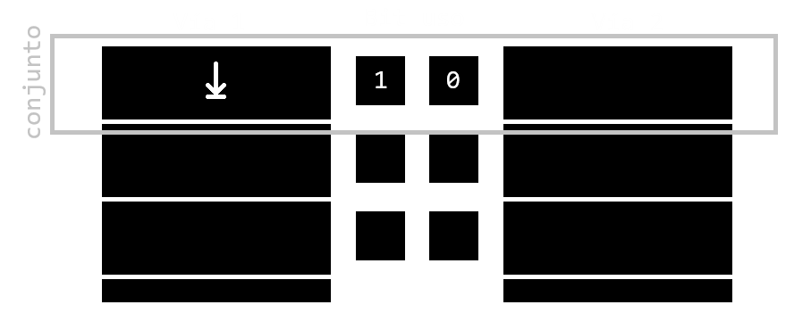

- **FIFO** (*First-in Last-out*)

    Sustituye los contenidos de forma **cíclica**, es decir, en cada momento se sustituye el bloque que haya permanecido por más tiempo.

- **LFU** (*Least Frequently Used*)

    Sustituye el bloque que haya sido **menos referenciado**. Su implementación requiere añadir un **contador** a cada línea.

- **Aleatoriamente**

### Política de escritura

Pretende encontrar la dirección de escritura en cuanto se modifica un dato puesto que este también está presente en **memoria principal**.

- **Escritura inmediata**
    
    Al actualizar un dato de la caché también se actualiza en memoria principal. Esto genera **tráfico** a una memoria cuyo tiempo de acceso es más lento.

- **Post-escritura**
    
    El **bloque completo** de la palabra actualizada queda marcada como **pendiente de actualización**. Si este bit está activo, se traslada la actualización al sobrescribir el bloque de caché.

    Al actualizar todas las palabras del bloque a la vez (**alterados y no alterados**), se produce una **pérdida de concordancia con mecanismos DMA** (véase DMA anteriormente)
    
    > Los DMA acceden a memoria principal sin pasar lor el procesador.

Los ordenadores ***multi-core*** obligarían a utilizar un único nivel de caché para evitar el **problema de coherencia de caché**, es decir, los cores comparten una parte de la caché y la memoria principal: al actualizar un contenido podría darse **actualización perdida**.

#### Posibles soluciones contra la coherencia de caché

Pretende solucionar el problema por los siguientes medios:

- **Vigilancia del bus con escritura inmediata**

    Las memorias caché de otros procesadores **vigilan el bus** desde una caché a memoria principal. Al detectar un espacio de memoria, si ya estuviera en sucaché, se **marca como inválido** de forma que intentar leerlo provoca un **fallo en la caché**.

    > **Requiere escritura inmediata**.

- **Transparencia *hardware***

    Existe un ***hardware* adicional** con la función específica de **mantener las memorias caché y principal actualizadas**.

- **Memoria excluida de caché** (*non-cacheable*)

    Sólo una porción de memoria principal se puede compartir por todos los *cores*. Esta **porción compartida** se diseña como **no transferible a caché**.

    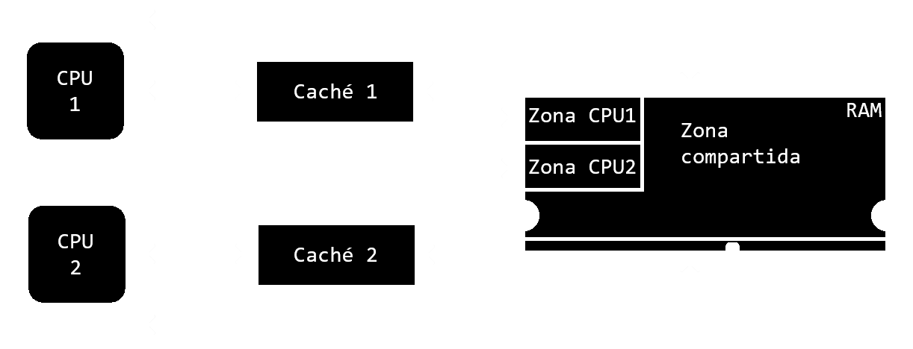

### Tamaño de una línea

El objetivo es determinar la relación óptima de ***words* por bloque**.

En principio, el principio de localidad de las referencias parece indicar que **un mayor número de palabras** debe llevar un mayor número de aciertos de caché. Sin embargo, a medida que aumentan, se sufren dos efectos:
- Un mayor tamaño en las líneas implica **menor cantidad de líneas**, es decir, se **obliga a sobrescribir más datos** para dejar espacio en los bloques.
- Cada **nueva palabra está más lejos**que la anteriormente referenciada de forma que se **reduce el efecto del principio de localidad**.

Estas condiciones implican que el rango óptimo oscila entre una cantidad de *words* que permita almacenar mucha información y que, al mismo tiempo, permita añadir nueva.

> Esta línea oscila entre 8 y 64 *words* aunque es sensible al avance de la tecnología.

### Números de cachés

Para ello hay que tener en cuenta niveles de caché.

#### Niveles de caché

Según dónde esté ubicada se puede hablar de memoria *on-chip* o memoria *off-chip*.

- **Memoria caché *on-chip***
    \
    Se encuentra en el **circuito integrado de la CPU**. Proporciona **mayor velocidad**.
- **Memoria caché *off-chip***
    \
    Se ubica en un circuito integrado externo entre la CPU y la memoria. Utiliza un **bus local** y es, sencillamente, peor que el caché *on-chip*.

A pesar de la clara ventaja, históricamente **no siempre se ha podido tener memoria *on-chip*** por lo que se aplicaban niveles:

- Dos niveles
    - *on-chip*: L1
    - *off-chip*: L2

- Tres niveles
    - *on-chip*: L1, L2
    - *off-chip*: L3

- Tres niveles (posterior)
    - *on-chip*: L1, L2, L3

#### Caché unificada o partida/separada

En el **nivel L1** hay dos posibilidades, estas son la caché unificada y partida.

- **Caché unificada**

    Una sola memoria en la que **coexisten datos e instrucciones**. Proporciona mayor simplicidad y **nivela los contenidos en función del momento**.

- **Caché partida**

    Divida la caché en dos secciones: **datos** e **instrucciones**. esto permite utilizar la **técnica de segmentación de cauce** (***pipeline***, véase próximamente) de forma que proporciona **dos vías de acceso** evitando la competición entre los datos de la instrucción actual y la próxima instrucción. La tecnología *pipeline* puede **duplicar el rendimiento** del computador.

    > La tecnología *pipeline* pide los **datos** de la instrucción actual y, al mismo tiempo, pide la próxima **instrucción**. Paralelizar la obtención de la información es similar a ejecutar dos instrucciones a la vez.

# TEMA 6: Entrada/Salida

Un **módulo** se conecta al bus del sistema por la **interfaz interna** y se conecta a los **periféricos** por la **interfaz externa**.

El **módulo de entrada/salida** permite la comunicación entre los periféricos y los **recursos internos del computaador** a través del **bus del sistema**.
\
El módulo intermediario debe existir por múltiples motivos: **diversidad** de periféricos, **seguridad** del circuito, **control** de acceso, **formato**...

