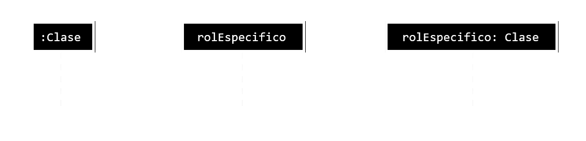
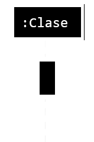
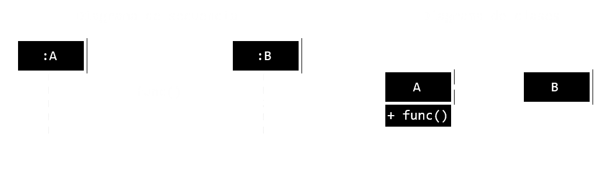

# **Diseño Tecnológico de Sistemas de Información**
*Autor:* Christian Velasco Pérez 
\
El siguiente contenido corresponde a un **apoyo** educativo para cualquier interesado y por eso puede contener fallos. El documento está orientado al curso de *Diseño Tecnológico de Sistemas de Información* del Grado en Ingeniería Informática de la Universidad de La Rioja y se considera completa responsabilidad del lector lo que haga con la información de este documento.
\
La distribución del documento queda reservada al permiso explícito de su autor. Si necesitase información de contacto puede [enviar un correo](mailto:velskopezz@gmail.com).

# TEMA 1: Programación orientada a Aspectos

El objetivo es **secularizar el manejo de errores** del módulo donde surgen para reunirlos en un único apartado.

## Elementos

El siguiente apartado trata el conjunto de componentes que se deben considerar en un sistema POA:

- **Componentes**
    \
    Son la parte de un módulo que interesa a nivel funcional.
- **Aspectos**
    \
    Refiere a aquello relativo a aspectos no funcionales como el control de errores o de acceso.

> Nota: Las transparencias hablan de
> - *Core concern*: Unidad encapsulable limpiamente.
> - *Cross-cutting concern*: Atraviesa diferentes módulos.

## Pasos a seguir

1. Se programan las **componentes** con normalidad. Seguido, se hacen los **aspectos** del código de forma **independiente entre ellos**.
2. Se utiliza el **weaver** para combinar la componente y el aspecto antes de la ejecución del programa.

## Conceptos básicos

> Sobre el documento: Probablemente falten por añadir. Avisad en Issues.

- **`joinpoint`**
    \
    Es un punto identificable del programa en el que se puede **añadir un comportamiento adicional**, por ejemplo, una llamada.
- **`advice`**
    \
    Delata el salto de un **punto de enlace**. Hay tres tipos:
    - `before`, antes.
    - `after`, después.
    - `around`, en su lugar.
- **`pointcut`** es el conjunto de todos los **puntos de enlace** que se utilizan para definir el momento de ejecutarse un **advise**.

## AspectJ

Fue inicialmente desarrollado por Xerox en 1998. Aunque también tiene crosscutting dinámico, en la asignatura se utilizará el estático.

Se pueden utilizar **anotaciones** (`@`) **o keywords**. Se distinguen:
- **`pointcut`s**: para puntos de corte.
- **`Logger`**: para el registro de los eventos.

Lo interesante de la cuestión es la **definición de puntos de corte**. Véanse ejemplos en las transparencias, aquí se proporciona uno.

```java
public aspect AspectoNombre {
    // Definición del pointcut
    pointcut nombrePointcut() : 
        execution(type package.class.method(args))
        /*&& . . . */;

    // Advice asociado al pointcut
    before() : nombrePointcut() {
        /* . . . */
    }
}
```

### *Joinpoints*

Vale la pena **distinguir el momento del enlace**. Puede ser motivo de error disponer el *joinpoint* **en la acción** en lugar de la **llamada que realiza la acción** (subrutina) o viceversa.

> Dicho fácil; poner el `call()` en lugar del `execution()`.

## *Pointcuts*

Pueden ser **específicos** o **generales**. Depende de ello el uso de **comodines** (`*`). Los generales también reciben el nombre de "**anónimos**".

Estos comodines son:

- **`*`**: indica un único parámetro en argumentos o todos los sub*packages*
- **`..`**: indica una cantidad cualquiera de argumentos incluyendo cero
- **`+`**: indica la inclusión de clases hijas

## Avisos

- **`before`**
    \
    Funciona de forma lógica.

- **`after`**
    \
    Funciona de forma similar al bloque `finally` de las estructuras `try-catch`.
    \
    Puede ser:
    
    - `after`
    - `after returning`
    - `after throwing`

- **`around`**
    \
    Proporciona la ejecución del hilo a dicha sentencia pudiendo **cambiar libremente el hilo de ejecución**. Se utiliza la *keyword* **`proceed`** para regresar al lugar del punto de enlace en lugar de alterar la totalidad del código.

### Prioridad entre avisos

Dependen del tipo del aviso de las **políticas de prioridad**.

- `before`: con ejecución secuencial, comienza el más prioritario y, luego, pasa el siguiente
- `around`: los más prioritarios encapsulan a los menos prioritarios
- `after`: con ejecución secuencial, comienza el menos prioritario y, luego, pasa el siguiente

#### Aspectos privilegiados

Altera el modificador de visibilidad. Debe usarse con cuidado pues rompe la encapsulación y seguridad de las clases.

> Se refiere a que se crean de la siguiente forma:
>
> ```java
> public privileged aspect AspectoPrivilegiado {
>     /* . . . */
> }
> ```
>
> Como se puede notar, su nivel de encapsulamiento es `privileged`. Esto le permite romper las reglas estándar de encapsulamiento de Java y acceder a los miembros privados y protegidos de cualquier otra clase.

# TEMA 2: Interfaces de usuario

Las interfaces tienen detrás toda su ciencia buscando **visibilidad** y **accesibilidad**.

> Nota del autor: Este tema está incompleto. Así como no se ponen cruces donde se mea; no se ponen clases en San Mateo.

# TEMA 3: Diagramas de diseño

> La información de este temario, por lo pronto, se omite debido a que su contenido está plenamente contenido en otra asignatura.
>
> Para más información, véanse Diagramas de Casos de Uso y Diagramas de Actividad en [Ingeniería del Software](../2º/Ingeniería_del_Software.md)

# TEMA 4: Diagramas de interacción

Es un diagrama que ilustra **elementos que interactuan** para proporcionar una funcionalidad más complejta.
\
Está **fuertemente ligado** al diagrama de clases. Es por ello que **todas las operaciones del diagrama de interacción deben figurar en el diagrama de clases**.

En un diagrama de interacción también se incluyen **elementos no humanos**. El objetivo es **modelar la interacción** y **representar la interacción y comunicación**.

Hay múltiples tipos de diagramas de interacción. La elección debería depender del énfasis que proporciona a mejor comprensión.

- **Diagrama de secuencia**
- **Diagraam de comunicación**
- Diagrama de visión global de interacción
- Diagrama de tiempos

> De acuerdo con UML, los diagramas de interacción se pueden traducir entre ellos sin perder información.

> Sobre el documento: No se ilustrará el diagrama de visión global de interacción ni diagrama de tiempos puesto que parece ser contenido secundario de la asignatura.

## Diagrama de secuencia

Se utiliza una ***lifeline*** (línea de vida) que recorre el tiempo para ilustrar una instancia. El nombre de cada una viene indicada por su clase, salvo que se trate de un rol específico de dicha clase.



> Las *lifelines* suelen disponerse de forma paralela.

Existen, además los **roles multivaluados** utilizan **selecotores** o seleccionadores para obtener una instancia específica (e.g.: nombreRol[selector]: Clase).

Una **especificación de ejecución** es una barra que indica la **actividad de la clase**. Se trata del **control** es opcional.



Los **objetos activos** tienen su propio flujo de control y operan de forma independiente a otros objetos. Suelen representar otros procesos o hilos.

### Mensajes

> e.g.: Relación entre diagramas de secuencia y clases
>
> 
>
> > Cita: Es el fallo más común en los exámenes.

Los **mensajes** se representan con flechas. Estas flechas podrán ser huecas o  rellenas dependiendo de condiciones.

- Una **flecha contínua rellena** indica que se proporciona una **información de emisión** e implica **sincronía**.

- Una **flecha contínua hueca** implica **asincronía**. Envía información y no espera respuesta.

- Una **flecha discontínua hueca** proporciona **respuesta a una flecha contínua rellena**. Su funcionamiento suele traducirse en una instrucción `return`.

")

- Los mensajes **encontrados** y **perdidos** llaman a otros objetos cuya *lifetime* no interesa para el diagrama.

### Avanzado

Existen una serie de **operadores** para **diagramas de secuencia avanzados**. 

En este documento no se explicarán con detalle los operadores. Tan solo se mencionarçan.

#### Ramificaciones y bucles
- alt: interacción alternativa
- opt: interacción opcional
- loop: interacción iterativa
- break: interacción de excepción

#### Concurrencia y orden
- seq: orden débil
- strict: orden estricto
- par: interacción concurrente
- critical: interacción anatómica

#### Filtros y afirmaciones
- ignore: partes de interacción irrelevante
- consider: partes de interacción relevante
- assert: interacción afirmada
- neg: interación no válida

## Diagramas de comunicación

Enfatizan la interacción entre las clases sobre la temporalidad de la comunicación. También utiliza **flechas vacías y rellenas**  de acuerdo con la **sincronización**.

En los diagramas de comunicación se **ignoran las respuestas** en froma de datos (`return`s) no así como las respuestas que conllevan la ejecución de otra subrutina, que se muestran **sobre la misma flecha**.

Las subrutinas vienen **enumeradas** para indicar el orden de ejecución. Estas enumeraciones pueden incluir subdivisiones (e.g.: 1.1.2.1) para reflejar mensajes encadenados por otros.


---