# **Intel 8086: Arquitectura de Computadores**
*Autor:* Christian Velasco Pérez 
\
El siguiente contenido corresponde a un **apoyo** educativo para cualquier interesado y por eso puede contener fallos. El documento está orientado al curso de *Arquitectura de computadores* del Grado en Ingeniería Informática de la Universidad de La Rioja y se considera completa responsabilidad del lector lo que haga con la información de este documento.
\
La distribución del documento queda reservada al permiso explícito de su autor. Si necesitase información de contacto puede [enviar un correo](mailto:velskopezz@gmail.com).

---

Durante las prácticas de la asignatura de [Arquitectura de Computadores](../../3º/Arquitectura_de_Computadores.md) se va a utilizar [lenguaje ensamblador](https://es.wikipedia.org/wiki/Lenguaje_ensamblador). Ello implica que es necesario conocer un procesador específico, en esta asignatura ese procesador será el [Intel 8086](https://es.wikipedia.org/wiki/Intel_8086_y_8088), conocido por ser el inicio de la [arquitectura x86](https://es.wikipedia.org/wiki/X86).

> El procesador 8086 es de 16 bits y divide el trabajo de procesamiento y transferencia para que funcione de forma paralelizada.

# Buses del sistema

Que el procesador sea de 16 bits no solo implica la cantidad de bits que almacenan los registros sino, también, la cantidad de **líneas de anchura** de datos de los buses.

-  **Bus de datos**

    Transporta los valores.

    En el Intel 8086 es de 16 bits.

- **Bus de direcciones**

    Transporta las direcciones. Con un procesador de $n$ bits se permiten $2^n$ direcciones.
    
    En específico, el Intel 8086 tiene 20 bits para las direcciones. En total, debería ser $2^{20}b = 2^{10} \cdot 2^{10}b = 1MB$ de valores direccionables. Desde la `0x 00 0000` hasta la `0x ff ffff`.

- **Bus de control**

    Se verá próximamente, transporta información de control de ciertas situaciones.
        
    > A pesar de lo dicho, no se verá próximamente.

Para llegar a registros de 20 bits se van a tener que **utilizar dos registros**, lo que dejará una holgura de $20b - 2 \cdot 16b = 12b$.

## Segmentación de la memoria

La memoria está dividida en **segmentos**. Estos segmentos contarán con un **desplazamiento** para formar una **dirección de memoria**.
\
Se calcula de la siguiente forma con el fin de que sólo se puedan direccionar direcciones disponibles:

$$\text{"direccion física"} = 16 \cdot \text{"segmento"} + \text{"desplazamiento"}$$

> Las direcciones físicas suelen escribirse en hexadecimal. Es por ello que la fórmula puede reescribirse en `dir_física = 10 * dir_segmento + desplazamiento`, lo que facilitará los cálculos.

> e.g.: Dirección `0000:1050`.
>
> segmento := `0x 0000`
> \
> desplazamiento := `0x 1050`
>
> dirección = `(0x 0000) * (0x 10) + (0x 1050) = (0x 00 1050)`
>
> > Si se hacen los cálculos, puede notarse que `0010:0f50`, `0100:0050` o `0105:0000`, por ejemplo, también direccionan la misma ubicación en memoria.

Es importante notar que las **direcciones de memoria están solapadas entre los segmentos**. A pesar de que deberían haber $64^2kB$ de espacio direccionable puesto que hay 64kB de segmento y 64kB de desplazamiento, en realidad sólo hay $1MB$ de espacio real de direcciones.

> Nótese que todas las direcciones de segmento acaban por `0x 0` yq ue todas las direcciones que acaben por `0x 0` indican el inicio de un nuevo segmento puesto que cada dirección de segmento se ve multiplicada por `0x 10`.

# Registros

Se identifica el tipo de acuerdo con un sufijo alfabético. Además existen una serie de **registros de estado**.

## Generador de direcciones

A partir de los registros se calcula la **dirección de memoria principal** que se corresponde.

## Identificación de registros

Los registros se identifican de acuerdo con el siguiente sufijo:

- **`X`**: generales
- **`I`**: índices
- **`P`**: punteros
- **`S`**: segmentos

Además de registros de **estado** que están en los *flags*.

> Los *flags* indican el resultado de la última operación de la ALU. Ello implica que, salvo operaciones de modificación directa de los *flags* (e.g.: `CLD`, `STC`...), los registros de estado se veran inalterados si una instrucción no requiere pasar por la ALU.
>
> > e.g.: **`MOV AX, 0` no levantará el *flag* `ZF`** porque `MOV` no es una instrucción aritmética ni lógica: no pasa por la ALU.

### Registros generales

Hay cuatro registros generales que pueden usarse de **forma generalizada** aunque **almacenan resultados normativos**.

> La notación `AH << 4 + AL` será equivalente a `AH:AL` siendo `AH` y `AL` registros de 1 byte.

Todos los registros generales ocupan 2 bytes y podrán dividirse en 2 partes de 1 byte cuyos sufijos serán `H` si son la mayor o `L` si son el menor.

> e.g.: `AX = AH:AL`, `BX = BH:BL`, etc

- **Acumulador** (`AX`)
        \
        Almacena los resultados de la ALU.

- **Base** (`BX`)
        \
        Almacena la dirección base de un array, sin su desplazamiento.

- **Contador** (`CX`)
        \
        Almacena la cantidad de veces que debe repetirse un bloque funcional.
    
- **Datos** (`DX`)
        \
        Apoya al acumulador en caso de overflow formando `DX:AX`. También almacena información en ciertas instrucciones de entrada y salida, inlcuyendo los puertos.

Por tanto, se pueden almacenar 32 bits, y con ello [números en coma flotante](https://es.wikipedia.org/wiki/IEEE_754), por medio de `DX:AX` ($2 \cdot 8b + 2 \cdot 8b = 32b$).

### Registros de segmento y desplazamiento

Hay ciertas combinaciones que hay que conocer:

- **`DS:SI`** (*Data Segment* : *Source Index*) apunta a a dirección de datos de lectura.
- **`ES:DI`** (*Extra Segment* : *Destination Index*) apunta a la dirección de datos de escritura.

- **`SS:SP`** (*Stack Segment* : *Stack Pointer*) apunta al tope del *stack*.
- **`SS:BP`** (*Stack Segment* : *Base Pointer*) apunta al inicio del marco de la pila (*stack frame*) para almacenar el contexto.

- **`CS:IP`** (*Code Segment* : *Instruction Pointer*) apunta a la siguiente instrucción que el procesador debe ejecutar.

### Registros de estado (*flags*)

Almacenan ciertas condiciones que puene suceder al operar en la ALU. Son un total de 9 ***flags*** de los cuales 6 de ellos son de **condición** y 3 de ellos son de **control**.

#### Registros de condición

*flag* | Nombre | Descripción
:--: | :-- | :--
**`CF`** | *Carry Flag* | Indica si la operación ha resultado con **acarreo**.
**`OF`** | *Overflow Flag* | Indica si la operación ha generado ***overflow***.
`AF` | *Auxiliary Carry Flag* | Indica si las sumas de BCD (4 últimos bits) tienen acarreo.
**`ZF`** | *Zero Flag* | Indica si el resultado de una operación es 0. También utilizado para operaciones de igualdad.
**`SF`** | *Sign Flag* | Indica si el resultado tiene signo (negativo). También utilizado para operaciones de igualdad.
**`PF`** | *Parity Flag* | Indica si la cantidad de dígitos a 1 en binario de ese número es par.

#### Registros de control

*flag* | Nombre | Descripción
:--: | :-- | :--
**`IF`** | *Interrupt Flag* | Habilita o deshabilita las interrupciones. Tras resetear el programa, `IF` siempre vuelve a `0`  (interrupciones deshabilitadas). Las interrupciones en el Intel 8086 deshabilitan las otras interrupciones.
`DF` | *Direction Flag* | Indica si la cadena se lee de forma creciente o decreciente.
**`TF`** | *Trap Flag* | Detiene el procesador tras cada instrucción para permitir facilitar el ***debug*** del código. Si está en `1`, el procesador genera una intrucción interna especial tras la instrucción actual.

## Modos de direccionamiento

Los modos de direccionamiento son las distintas formas de proporcionar **operandos** a una instrucción.

Estas instrucciones utilizarán números que podrán estar en distinto sistema de numeración, para conocer la numeración se utiliza un **sufijo**.

- **`b`**: binario
- `o`: octal
- **`h`**: hexadecimal
- **`d`** (o ninguno): decimal

> Cuando se manejan números hexadecimales se recomienda poner un 0 delante del número (e.g.: `0ABCDh`). Esto se debe a que el ensamblador debe identificar el valor como número, si comenzase por un dígito con valor superior a 9 entonces comenzaría por una letra y el ensamblador lo identificaría con una variable.

### Variable

Representa el **desplazamiento** de un segmento donde comienza un dato en memoria. Las variables permiten una identificación semántica de una dirección de memoria.

También proporciona una posibilidad de automatización durante el ensamblado. Hacer la tarea de forma manual es un riesgo, es mejor dejársela al ensamblador.

#### *Big* & *Little Endian*

Los datos de 2 o más bytes pueden almacenarse en múltiples celdas disponiéndolas de forma ordenada creciente o decreciente. Se trata del *Big Endian* y el *Little Endian*, y su uso depende del fabricante del procesador. En el caso de Intel 8086, se utiliza *Little Endian*.

> e.g.: *Big Endian*
> \
> `0001 0002 h` se almacena como [`0001h`][`0002h`]
> \
> Suponiendo direcciones de memoria consecutivas.

> e.g.: *Little Endian*
> \
> `0001 0002 h` se almacena como [`0002h`][`0001h`]
> \
> Suponiendo direcciones de memoria consecutivas.

#### Modo implícito

Se hace de forma implícita.

> e.g.: `CLC`

#### Modo inmediato

El valor del operando forma parte de la instrucción, es decir, utiliza una **constante numérica**.

> e.g.: `MOV AX, 5000h`

#### Modo de registro

El valor del operando es proporcionado por medio del **nombre de un registro**.

> e.g.: `MOV AX, BX`

#### Modo directo

También llamado absoluto, la dirección se proporciona por medio de una **variable**. El segmento por defecto será el `DS` (*Data Segment*).

> Nótese que una variable en ensamblador representa un desplazamiento.

> e.g.: `MOV AX, [2000h]`

#### Modo indirecto

Similar al modo directo. Utiliza registros en lugar de variables.

> e.g.: `MOV AX, [BX]`

> También es posible utilizar sumandos (e.g.: `MOV AX, [BX + 3]`). Esto es el modo **indirecto por base**

> También es posible utilizar registros en sumandos (e.g.: `MOV AX, [BX + SI]`). Esto es el modo **indirecto por direccionamiento**

> También es posible utilizar variables en sumandos. Ello sería el modo **indexado por índice**.

# Proceso de ensamblado

Se utilizaran **pseudoinstrucciones**, es decir, instrucciones que permiten pasar de forma directa o casi directa a lenguaje máquina. Se consideran instrucciones para ensamblar. La máquina **sólo puede ejecutar instrucciones**.

> Las pseudoinstrucciones no se pasan de forma física. Muchas de ellas ni siquiera tienen un CODOP asociado sino que se componen de varios de ellos.

## Pseudoinstrucciones

Sólo se pueden utilizar en **tiempo de ensamblado**. En realidad, los cambia el ensamblador

> e.g.: El operador `+` no se utiliza en tiempo de ejecución. Si bien `ADD` sí es una operación dinámica, el operador `+` sólo puede sumar números constantes por lo que el ensamblador calcula la suma en tiempo de ensamblado y el resultado queda como constante en el binario ejecutable.

## Variables

Requieren un **nombre**, **tamaño**, y **valor inicial**.

- **nombre**: Se podrá omitir en ciertos casos.

- **tamaño**: Uno entre los siguientes

    - *Data Byte* (`DB`): 1B
    - *Data Word* (`DW`): 2B
    - *Double Word* (`DD`): 4B

- **valor inical**: Se puede omitir. Para ello se asigna `?`.

> Una variable sin inicializar se considera a 0, aunque puede guardar basura.

## Etiquetas

Es un símbolo que almacena las **referencias a las intrucciones**. Estas permiten materializar bucles y otras funciones. Son el análogo de las variables con los datos pero a las instrucciones.

Tipo | Contenido | Saltos | Anotación
--: | :-- | :-- | :--
**`NEAR`** | desplazamiento (16b) | dentro del segmento | precedido por `:`
**`FAR`** | segmento y desplazamiento (32b) | entre segmentos | 

## Repertorio de instrucciones

### Operadores aritméticos

- `MOV <destino>, <fuente>`: Los tamaños deben coincidir.
- `XCHG <dato>, <dato>`: Intercambia los valores.
- `LEA <destino>, <variable>`: Obtiene el desplazamiento de la variable. Similar a `MOV <destino>, OFFSET <fuente>`.
- `ADD <destino>, <fuente>`: Suma. Almacena el resultado en el destino.
- `ADC <destino, <fuente>>`: Similar a `ADD` pero suma `CF`.
- `SUB <destino>, <fuente>`: Resta. Almacena el resultado en el destino.
- `SBB <destino>, <fuente>`: Similar a `ADC` con restas.
- `CMP <operando>, <operando>`: Cambia los *flags* sin almacenar el resultado.
- `MUL <fuente>`: Sin signo. `AX <- <fuente> * AL`, `DX:AX <- <fuente> * AX` si hiciera falta.
- `IMUL <fuente>`: Con signo.
- `DIV <fuente>`: Sin signo. `AX / <fuente> = AL + AH / <fuente>` o `DX:AX / <fuente> = AX + DX / <fuente>`.
- `IDIV`: Con signo.
- `INC <destino>`: Incrementa en 1.
- `DEC <destino>`: Decrementa en 1.
- `CBW`: Convierte de byte a word. Replica el bit de signo.
- `CWD`: Convierte de word a double word. Replica el bit de signo.
- `NEG <operando>`: Hace el opuesto en C2.

### Operadores lógicos

Ejecutan operaciones **bit a bit**.

- `AND <destino>, <fuente>` 
- `OR <destino>, <fuente>`
- `XOR <destino>, <fuente>`
- `NOT <operando>`
- `TEST <operando> <operando>`: Operación `AND` sin almacenar el resultado, sólo cambia los *flags*.

### Operadores de desplazamientos

Están formados por 3 componentes: [`S`][`H|A`][`L|R`]-

- `SH`: *shift*
- `SA`: *shift arithmetic*
- `L`: *left*
- `R`: *right*

Tanto `R` como `L` sólo indica el lado desde el que se hace. Esto será igual en rotaciones.

> e.g.: `SHL` introduce el número 0 desde el lado izquierdo. En el `CF` se almacena el último bit que sale. Es equivalente al operador `<<` en C++.

> e.g.: `SAL` es similar a `SHL` pero tiene en cuenta el **bit de signo**.

### Operadores de rotación

Nuevamente cuenta con 3 componentes [`R`][`O|C`][`L|R`].

- `RO`: *rotate*
        
    Introduce el bit de salida en el de entrada. Replica el último bit salido en el `CF`.

    

- `RC`: *rotate carry*

    Introduce el bit de salida en el de entrada. También se rota pr el `CF`.

    

## Saltos

Se llama por medio de `JMP <destino>`. Los saltos **incondicionales** saltan siempre.

- **`NEAR`**: Para el mismo segmento, sólo se proporciona un byte, `IP` recibe el destino.
- `FAR`
- **`SHORT`** para una distancia relatva de [-128, 127] byts. las instrucciones suelen pesar más de un byte y, por ello, hay de tipo **abstracto** y **relativo**.

### Saltos condicinoales

Todos los saltos condicionales son de **tipo `SHORT`**. Funcionan de la forma `JXX <destino> :<etiquta>`. Hay una tabla en las transparencias con las indicaciones específicas respecto al `JXX`. Aquellas cuya condición no es de igualdad, dependen de la **notación con/sin signo**. El salto dependerá del cambio en los ***flags***.

Para hacerlo correctamente, se hace un salto a un salto incondicional.

### Bucles

Se utiliza el registro **`CX`** (*Count Register*). Decrementaremos `CX` las veces que sean necesarias.

> De forma similar a un bucle *for*, hasta que `CX = 0`.

# Ejecución

## Pila (*stack*)

La pila funciona de forma creciente. Hay un puntero hacia el segmento de la pila y esta se va llenando por medio del desplazamiento en `SP`.

- `PUSH <fuente>`

    ```
    SP <- SP - 2
    SS:SP <- <fuente>
    ```

- `POP <destino>`

    ```
    <destino> <- SS:SP
    SP <- SP + 2
    ```

- `PUSHF/POPF`

    Apila o desapila los *flags*.

- `PUSHA/POPA`

    Apila o desapila toda la pila.



## Comunicación con periféricos

- `IN <acumulador>, <puerto>`
- `OUT <puerto>, <acumulador>`

Del acumulador se usará `AL` si se necesita 1B o `AX` si se necesitan 2B. Los puertos inmediatos son desde `0x 00` hasta `0x ff`. Los puertos indicados por `DX` son desde `0x 0000` hasta `0x ffff`.

## Procedimientos

Se habla de las **subrutinas**.

- `CALL <nombre>`: Guarda la dirección de retorno y lleva a la subrutina.
- `RET` : Lleva de vuelta a la ubicación original. Lo sabe por el SS:SP.

> `PROC` y `ENDP` son instrucciones de ensamblado.